# nfl

Fantasy football toolkit. Ingests public NFL player/stat data, scores it, ranks
players, and builds a weekly lineup.

> **Two parts, one repo:**
> 1. **Toolkit** — ingest, score, rank, project, and model NFL players (sections below).
> 2. **FD nation Yahoo operation** — a self-contained module that reads and
>    maintains a specific Yahoo league's roster through the browser. See
>    [FD nation Yahoo operation (module)](#fd-nation--yahoo-league-operation-module).
>
> **New here? Read the [Code Guide](docs/CODE_GUIDE.md)** — every file
> explained in detail, with colored mermaid charts of what each function
> does, organized by layer (engine · Yahoo · tools · Rust web · tests).
> For the Rust web UI specifically, see the
> [Rust web architecture guide](docs/RUST_WEB_ARCHITECTURE.md).

## What is fantasy football? (ELI5)

Imagine you're a coach, not a player. Before the NFL season you "draft" real
players onto your own fake team. Every week those real players rack up points from
what they actually do in games — touchdowns, yards, catches, field goals. Your
team's points go head-to-head against another person's team; the higher score
wins that week. Do it for ~15 weeks and the best record (or playoff bracket) wins
the league. It's a season-long game of "which real players will do best?"

## Is money involved?

It depends on the league — this repo doesn't decide that. Many leagues are free
and just-for-fun among friends; others have a small buy-in or prizes. **This
codebase is a pure analysis + automation tool**: it builds projections, ranks
players, and (for FD nation) operates the roster. It is **not** a betting or gambling
system and it places no wagers. See the honesty notes under
[Known limitations](#known-limitations) and
[FD nation → Honest limitations](#honest-limitations).

## Architecture

One picture, six colors: **blue** = external data sources, **green** = the
robots on this Mac (cron + launchd), **amber** = local artifacts (the only
thing the web layer reads), **pink** = the web process, **purple** = the
public edge, **teal** = you.

```mermaid
flowchart TB
    subgraph SRC["🌐 External data sources"]
        YAHOO["Yahoo Fantasy<br/>league 1329011<br/>WAF-sensitive: gentle, paced reads only"]
        ESPN["ESPN public API<br/>scoreboard + boxscores<br/>free, no auth, NOT Yahoo"]
        NFLVERSE["nflverse GitHub releases<br/>weekly stats · play-by-play · schedules"]
        CDN["Logo CDNs<br/>s.yimg.com / cloudinary"]
    end

    subgraph ROBOTS["🤖 This Mac — cron + launchd"]
        CRON["crontab: 9 jobs<br/>operator 2×/day · lineup applies Sun/Mon<br/>nightly league snapshot · game-day light refresh<br/>Wed waiver scan · Sun profile backup"]
        OPER["team_operator.py<br/>preflight → roster → projections<br/>→ monitor + lineup proposal<br/>--apply submits via CDP"]
        LEAG["league_report.py<br/>standings · scoreboard · all 10 rosters<br/>+ Yahoo Proj Pts + logo sync"]
        LIVE["live_points.py (launchd)<br/>10s change-gated ESPN poll<br/>exact Yahoo weights · drift check"]
        PRED["predictions_report.py (launchd)<br/>offline Python engine: projections ·<br/>win model · ratings · strategy · SOS"]
        CHROME["Chrome CDP :9222<br/>logged-in Yahoo session<br/>loopback only"]
    end

    subgraph ARTIFACTS["📦 Local artifacts — git-ignored, the web's only input"]
        OPJSON["logs/team-operator.jsonl<br/>run history + lineup plans"]
        LGJSON["logs/league-report.json<br/>+ season history .jsonl"]
        LPJSON["logs/live-points.json<br/>live player points + team totals"]
        ARCH["logs/live-points-week-N.json<br/>permanent weekly finals archive"]
        PINS["data/pins.json 📌<br/>manual start/sit locks"]
        LOGOS["data/logos/ + logos.json"]
        SCORING["data/league-scoring.json<br/>authoritative Yahoo weights"]
        CORPUS["data/raw + data/processed<br/>nflverse corpus · trained models"]
        DATAWEB["data/web/*.json<br/>prediction-engine page data<br/>(dashboard · players · predictions ·<br/>ratings · strategy · SOS · modelcard)"]
    end

    subgraph WEB["🦀 Web layer — loopback only"]
        AXUM["nfl-webd · Rust/axum · :5000<br/>ALL pages native: /league (home) · /team<br/>/cron · matchup · dashboard · players<br/>predictions · ratings · strategy · SOS<br/>/live-points · /ws · /api/*"]
    end

    subgraph EDGE["☁️ Public edge"]
        TUNNEL["cloudflared quick tunnel<br/>ephemeral trycloudflare URL<br/>unauthenticated — treat as a secret"]
    end

    subgraph HUMAN["🧑 You"]
        UI["Browser<br/>League · My Team · Cron<br/>live scores over WebSocket<br/>📌 pin toggles"]
    end

    YAHOO -->|paced reads| CHROME
    CHROME --> OPER
    CHROME --> LEAG
    CRON --> OPER
    CRON --> LEAG
    ESPN -->|1 scoreboard/cycle<br/>summary only on a new play| LIVE
    SCORING -->|weights| LIVE
    NFLVERSE --> CORPUS
    CORPUS -->|projections| OPER
    OPER -->|reads 📌 never moves pinned| PINS
    OPER --> OPJSON
    OPER -->|lineup --apply| YAHOO
    LEAG --> LGJSON
    LEAG --> LOGOS
    CDN -->|images| LOGOS
    LIVE --> LPJSON
    LIVE -->|every game final| ARCH
    LIVE -.->|reconcile vs fresh snapshot| LGJSON
    OPJSON --> AXUM
    LGJSON -->|rosters + season history| AXUM
    LPJSON -->|watch + broadcast| AXUM
    ARCH -->|past weeks| AXUM
    PINS --> AXUM
    LOGOS --> AXUM
    CORPUS -->|projections + features| PRED
    PRED -->|daily 06:12 + Wed 21:05| DATAWEB
    DATAWEB -->|analytics pages| AXUM
    TUNNEL -->|forwards to :5000 only| AXUM
    UI <-->|HTTPS + WSS| TUNNEL

    classDef src fill:#1e3a5f,stroke:#4a90d9,color:#ffffff
    classDef robot fill:#2d4a22,stroke:#6abf4b,color:#ffffff
    classDef art fill:#4a3b1e,stroke:#d9a441,color:#ffffff
    classDef web fill:#4a1e3b,stroke:#d941a4,color:#ffffff
    classDef edge fill:#3b1e4a,stroke:#9b41d9,color:#ffffff
    classDef human fill:#1e4a4a,stroke:#41d9d9,color:#ffffff
    class YAHOO,ESPN,NFLVERSE,CDN src
    class CRON,OPER,LEAG,LIVE,PRED,CHROME robot
    class OPJSON,LGJSON,LPJSON,ARCH,PINS,LOGOS,SCORING,CORPUS,DATAWEB art
    class AXUM web
    class TUNNEL edge
    class UI human
```



How to read it, in one paragraph: the **robots** (green) are the only
processes that ever talk to Yahoo — slowly, through one logged-in Chrome
tab, on cron schedules — or compute the analytics. Everything they learn
lands in **local artifacts** (amber). The **web layer** (pink) is a single
Rust process that never touches Yahoo or ESPN and never computes: it
serves EVERY page — fantasy and prediction-engine alike — straight from
those files, and pushes live points to your browser over a WebSocket the
moment the poller writes a new artifact. The Python engine (pandas /
sklearn) still does the thinking, but OFFLINE: the `predreport` agent
writes `data/web/*.json` daily, so analytics pages are millisecond
artifact reads instead of multi-second Flask request-time computation.
The **purple tunnel** is the sole public door, forwarding to :5000. Two
independent data paths keep points honest: projections come from nflverse
via our model, while **live** points come from ESPN raw stats converted
under the exact Yahoo league weights (amber `league-scoring.json`),
validated 15/15 against Yahoo's own finals and continuously reconciled
against Yahoo's snapshot.
Once every game of a week is final, the poller archives it permanently
(`live-points-week-N.json`) — Matchup's week selector reads those archives
plus the season history to browse any past week's matchups.

## Contents

- [What is fantasy football? (ELI5)](#what-is-fantasy-football-eli5)
- [Is money involved?](#is-money-involved)
- [Architecture](#architecture)
- [Data source](#data-source)
- [Setup](#setup)
- [CLI](#cli)
- [2026 projection engine](#2026-projection-engine)
- [Win-probability model](#win-probability-model-predicting-the-winning-team)
- [Web UI](#web-ui)
- [Scoring](#scoring)
- [Tests](#tests)
- [Known limitations](#known-limitations)
- [FD nation Yahoo operation (module)](#fd-nation--yahoo-league-operation-module)

## Data source

Player stats, rosters, and schedules are pulled from the public
[nflverse-data](https://github.com/nflverse/nflverse-data) GitHub release assets
(no API key required). Data is cached under `data/raw/` and not committed.

**Provenance chain — why our numbers match Yahoo's.** Every NFL stat originates
from in-stadium official scorers feeding the league's central database (GSIS,
Game Statistics & Information System), audited by the Elias Sports Bureau, the
NFL's official statistician. Elias/the league office issue **official stat
corrections** during the week (typically landing Thursday US). The feed reaches
consumers through licensed distributors (Sportradar is the NFL's official data
distribution partner); Yahoo applies the same corrections, and nflverse scrapes
the same official play-by-play from nfl.com — one source, two paths. Player
*tracking* data (snap counts, separation) is a separate feed: Next Gen Stats
(Zebra RFID chips + AWS). Practical rule: midweek, our tables and Yahoo's can
briefly drift until corrections land — re-run `python cli.py ingest --refresh`
after Thursday (US) corrections, before weekend lineup decisions.

The "current" season is configured in `src/config.py`:
- `SCHEDULE_SEASON = 2026` — the game schedule we pull.
- `STATS_SEASON = 2026` — the current season; 2026 weekly player stats flow in
  as nflverse publishes them (re-run `python cli.py ingest --refresh` to pull).

## Setup

```bash
python3 -m venv .venv
source .venv/bin/activate
pip install -r requirements.txt
python cli.py ingest        # download + cache data into data/raw/
```

## CLI

```bash
python cli.py ingest                  # download + cache nflverse data
python cli.py schedule                # print the 2026 game schedule
python cli.py rank --preset ppr --top 15
python cli.py week 9 --preset half-ppr --top 10
python cli.py lineup --preset ppr
python cli.py validate                # compare our scoring vs nflverse's shipped numbers

# --- 2026 projection engine ---
python cli.py corpus                  # download + assemble the full 2026 corpus (~80MB)
python cli.py projections --top 30   # 2026 projections (multi-year + role + SOS)
python cli.py consistency --top 30   # weekly consistency / boom-bust
python cli.py matchups 1 --top 25    # 2026 Week 1 start/sit board
python cli.py sos                     # 2026 team strength-of-schedule ranking
```

Presets: `standard`, `ppr`, `half-ppr`, `fd-nation`. The default `fd-nation`
profile matches the authenticated Yahoo settings (verified 2026-09-01,
re-verified against the full settings table 2026-11-20 — see
`data/league-scoring.json`): 0.5 points per reception, 4-point passing
touchdowns, and -1 per interception.
The generic presets retain nflverse's -2 interception weight so `validate`
continues to compare like-for-like against nflverse's shipped columns. Most
commands accept `--season <YEAR>` to override the stats year (the schedule
command uses `SCHEDULE_SEASON`).

## 2026 projection engine

`corpus.py` assembles a projection corpus from nflverse:
- historical weekly player stats **2022-2026** (nflverse `stats_player_week_{y}`
  release assets, in-season 2026 weeks included as they publish),
- the **2026 roster** (`players`) and **2026 depth charts** (`depth_charts_2026`)
  for role/starter status,
- the **2026 schedule** (`games`) filtered to 2026,
- **derived team defense** (points allowed) computed from the games table.

`projections.py` produces 2026 projections in five transparent steps:
1. **Weighted baseline** — per-game fantasy mean across 2022-2026, recent seasons
   weighted more (1.0 / 1.5 / 2.0 / 2.5 / 3.0; the current season pulls hardest).
2. **Regression to the mean** — blended with the position league mean by a
   confidence weight that grows with games played (lightly-used players pulled
   toward average).
3. **Role adjustment** — scaled by 2026 depth-chart role share (starters ~0.60).
4. **Strength-of-Schedule** — adjusted by the average defensive SOS of the
   player's 2026 opponents.
5. **Rookie prior** — draft-class players with no NFL history are injected with
   a position-mean baseline scaled by depth-chart role and a draft-capital
   discount, so rookies appear on the board with honest, conservative
   projections instead of being invisible.

`analysis.py` adds consistency (CV, boom/bust rates), SOS rankings, and a
weekly matchup/start-sit board.

## Win-probability model (predicting the winning team)

`src/model.py` trains a **calibrated** logistic-regression model to predict
`home_win`, benchmarked honestly against the Vegas-favorite baseline. Features come
from `src/features.py`, which engineers them from **play-by-play** (not season
summaries) with strict leakage control.

### Feature engineering (`src/features.py`) — the rigor layer
- Team efficiency is computed from play-by-play (offense/defense EPA per play,
  success rate, red-zone TD rate, 3rd-down EPA, pass/rush EPA split).
- Ratings are **as-of** each (season, week): a game in week W uses team ratings
  built only from weeks 1..W-1 of that season; week 1 uses the most recent
  **strictly-prior** season's full-year efficiency. No future games leak into a
  game's features.
- When no leakage-free prior exists — 2022 week 1, the first season we hold PBP
  for — the game is **dropped** rather than rated on a future season. That costs
  16 of 1,087 games (2022–2025). See `docs/archive/REMEDIATION.md` #17: this was a real
  bug until 2026-08-31, when `max([...prior seasons] + [STATS_SEASON])` rated
  every week-1 game from 2022 to 2025 on full-year **2025** data.
- Results are cached to `data/processed/` (csv.gz) for fast, reproducible reads.
  Delete a cache (or pass `refresh=True`) after changing the window logic.

### Model evaluation (`src/model.py`)
- Strict time-based train/test split (train 2022–23, test 2024–25).
- Time-series (expanding-window) cross-validation for stability.
- Probability calibration (Platt) + accuracy / log-loss / Brier reported.
- Reported **both with and without** the Vegas spread as a feature.

Fantasy-player projections have a separate leakage-controlled historical
backtest. Run `python tools/backtest_projections.py` and see
[`docs/PROJECTION_BACKTEST.md`](docs/PROJECTION_BACKTEST.md) for 2025 rank
correlation, PPG error, positional hit rates, and baseline comparisons.

Real results (2022–2025 PBP, 1,071 games after dropping the 16 with no
leakage-free prior; train 2022–23 = 527, test 2024–25 = 544):

| | Accuracy | Log-loss | Brier |
|---|---|---|---|
| Model WITHOUT spread | **61.2%** | 0.654 | 0.231 |
| Model WITH spread | **68.0%** | 0.616 | 0.214 |
| Vegas-favorite baseline | **68.4%** | — | — |

Time-series CV (expanding window): 2023 63.2%, 2024 69.5%, 2025 66.2%,
**mean 66.3%**.

These figures were re-measured on 2026-08-31 after fixing the week-1 leakage bug
(#17). The previously published numbers (60.9 / 68.2 / 68.4 / 67.0) were measured
on leaked features; the honest numbers are within ~0.7pp of them. The bug was
severe in principle — every week-1 game from 2022 to 2025 was rated on full-year
2025 data — but week 1 is only 64 of 1,087 games, so the headline accuracy barely
moved. Detail in `docs/archive/REMEDIATION.md`.

Beating the closing spread is genuinely hard, so the model is built to *match* it
and is reported honestly — not overstated. Analytical tool, not a betting system.

Run `python cli.py predict` for 2026 win probabilities (add a week number, e.g.
`predict 1`, to narrow it).

Two calibrated variants are fitted on the completed seasons and cached to
`data/processed/win_prob_model.joblib`; predictions use whichever applies and
record it in a `model` column:

- `with_spread` — used when the game's spread is already published. More
  accurate, but it largely tracks Vegas (on 2026 week 1 it picks the same
  favourite in 16/16 games).
- `no_spread` — EPA and rest only. Less accurate (61.2%) but it is the variant
  that expresses an independent opinion rather than echoing the line.

Only weeks with published 2026 play-by-play are computable: later weeks need
in-season PBP to build as-of ratings, and `team_ratings_asof()` returns empty
rather than scoring a week-12 game on week-1 knowledge. `cli.py predict` skips
those weeks with a warning.

### Game-strategy analysis (`src/features.py: strategy_breakdown`)
Situation-level splits per team from PBP: overall, red-zone, 3rd-down, pass vs
rush EPA/play, success rate, and pass/shotgun tendency.

## Web UI

ONE loopback process (the jra-van-re method, applied to everything):
**nfl-webd** (Rust/axum, `rust/`) on 127.0.0.1:5000 serves EVERY page
natively with minijinja over `web/templates/` — the fantasy pages
(`/league` home, `/team`, `/team/pin`, `/league/team/<name>`,
`/league/matchup`, `/cron`, `/logos/<file>`, `/live-points`, `/ws`) AND
the prediction-engine pages (`/dashboard`, `/players`, `/player/<id>`,
`/predictions`, `/ratings`, `/strategy`, `/sos`, `/api/predictions`,
`/api/modelcard`). There is no Flask and no reverse proxy anymore: the
Python engine computes OFFLINE via `tools/predictions_report.py` into
`data/web/*.json` (the `com.fdnation.predreport` launchd agent: daily
06:12 JST + Wed 21:05 after the waiver/data refresh), and the analytics
handlers are pure artifact reads — milliseconds, never request-time
corpus builds or model training. Missing artifacts render an honest
notice telling you to run the producer.
`/` redirects to `/league` (League is the default page; menu order
League · My Team · Cron). "My Team" is a plain link to the operator view
(`/team`). Both the `/team` and `/league/team/<name>` pages have an on-page
"Viewing team" dropdown (below the heading, NOT in the top menu) listing all
league teams; selecting one jumps to that team's page. Team names in the
League standings/matchup cards are links too. The model-card dashboard lives
at `/dashboard`.
The public tunnel points at :5000 only.

On `/team` you can pin players (📌) to freeze their current slot: the
operator's `--apply` cron runs never move a pinned player, so manual
start/sit choices survive the automated lineup set. Pins live in
`data/pins.json` (git-ignored); a corrupt pin file fails the operator closed
(`pins_error`). See `docs/TEAM_OPERATOR.md` → "Manual pins".

```bash
cd rust && cargo build --release                  # build the web daemon
python tools/install_launchd.py --agent web       # nfl-webd :5000 (all pages)
python tools/install_launchd.py --agent predreport # offline analytics producer
python tools/predictions_report.py                # manual artifact refresh
```

### Public tunnel (optional, ephemeral — same method as jra-van-re)

A Cloudflare quick tunnel can expose the app beyond localhost:

```bash
python tools/install_launchd.py --agent cloudflared   # install + load the LaunchAgent
cat logs/cloudflared-url.txt                          # the live public URL
```

This runs `cloudflared tunnel --no-autoupdate --url http://127.0.0.1:5000`
under launchd (`com.fdnation.cloudflared`, KeepAlive). A watcher
(`tools/launchd/cloudflared-url-watch`) publishes the live
`https://*.trycloudflare.com` URL to `logs/cloudflared-url.txt` (mode 0600)
only once the edge actually serves the app. Caveats, same as jra-van-re's:
the URL is **ephemeral** (new one every cloudflared restart — nothing
bookmarkable), **unauthenticated** (anyone with the URL can read every page —
treat the URL file like a password), and the tunnel only forwards to
127.0.0.1:5000 — nfl-webd must be running too: install it persistently via
`python tools/install_launchd.py --agent web` (`com.fdnation.web`,
KeepAlive, logs in `logs/web.log`). The old `cli.py web` subcommand and
the Flask web backend (`web/app.py`, `com.fdnation.backend`) were removed
when all pages moved to Rust; the Python engine lives on in `src/` +
`tools/predictions_report.py`.

Pages: **league** (home — standings, GameChannel-style matchup cards with
team logos, live scores over WebSocket; hovering a card selects it and
clicking anywhere on it opens the matchup detail — Yahoo's `/matchup`
interaction, a pure-CSS stretched link), **matchup**
(`/league/matchup/<team>` — clean path URL: the selected team is a path
segment, no `?a=&b=`; the opponent for that week is FIXED by the schedule —
shown as locked text, never a pickable dropdown. `?week=N` browses past weeks
from the season history + weekly points archives),
**my team** (latest operator report: matchup, lineup plan, monitor flags,
📌 pin toggles), **cron** (operator run history + schedule), dashboard
(projections + model card), players (search + per-player history/projection),
win predictions by week, team **ratings**, game **strategy** breakdowns,
and SOS ranking. API: `/api/modelcard`, `/api/predictions`.

The fantasy pages read only local artifacts written by the cron/launchd
operators — `logs/team-operator.jsonl`, `logs/league-report.json` (+ the
append-only `.jsonl` season history), `logs/live-points.json`, the weekly
finals archives `logs/live-points-week-N.json`, `data/pins.json`,
`data/logos.json` — and the analytics pages read only `data/web/*.json`
written by `tools/predictions_report.py`. The web process never touches
Yahoo or ESPN live and never computes.

### Team logos (cron-captured)

`tools/logo_sync.py` reads each team's avatar URL from the league home page
standings table (free evaluate on the page `standings()` already loaded) and
downloads the images from the public CDNs (s.yimg.com / cloudinary) into
`data/logos/<team_id>.<ext>` with a `data/logos.json` manifest. It is wired
into `tools/league_report.py`, so every cron run (nightly `--all-rosters` and
game-day `--light`) keeps logos fresh; unchanged URLs are cached and never
re-downloaded. Type is sniffed from magic bytes (cloudinary URLs have no
extension). Fail-soft: a logo failure is a warning, never a broken report.
nfl-webd serves them at `/logos/<file>` (strict filename allowlist, no
traversal) and the league matchup cards, Matchup headers, and team pages
show them, falling back to initials when a logo is absent. Both `data/logos/`
and the manifest are gitignored — managers' custom logos can be personal
photos. Manual retry: `python tools/logo_sync.py`.

### Live points (realtime, Yahoo-exact)

Requirement: live fantasy points must match Yahoo — no drift. The pipeline:

1. **Authoritative weights**: `data/league-scoring.json` is transcribed from
   the Yahoo league settings page (the single source of truth; re-capture
   from Yahoo if settings change, never hand-tune).
2. **Poller**: `tools/live_points.py` (launchd agent `com.fdnation.livepoints`,
   `--loop`) polls ESPN's free public scoreboard/boxscore APIs — NOT Yahoo,
   so zero WAF risk — on a ~10s cycle during games, sleeping between
   windows. Polite by construction: one scoreboard request per cycle, and
   a game's summary is re-fetched only when its scoreboard signature
   changed (period, clock, scores, `situation.lastPlay.id`) — stopped
   clocks cost zero summary requests; a forced sweep every ~60s catches
   stat corrections; requests are staggered >= 0.25s apart with jittered
   sleeps; final games are fetched once and cached. `--interval` tunes the
   cycle (floor 5s — faster is spam, not freshness).
   `src/live_scoring.py` converts raw stats under the Yahoo weights,
   including the tricky bits: 2-point conversions (hidden in ESPN's TD-play
   parentheticals), FG distance tiers from scoring plays, DEF points-allowed
   tiers, safeties/blocks/return TDs, fumbles lost. Writes
   `logs/live-points.json` atomically.
3. **Accuracy gate**: `tests/test_live_scoring.py` freezes real ESPN week-10
   fixtures against Yahoo's own finals for all 15 roster players — 15/15
   exact to 0.01. At runtime the poller reconciles team totals against the
   Yahoo light-cron snapshot; a FRESH snapshot (<= 3 min) differing by > 0.5
   sets `drift=true` and the UI shows Yahoo's verified number instead.
4. **Push**: nfl-webd enables axum's `ws` feature; a watcher broadcasts every
   artifact change to `/ws` subscribers (30s pings keep the tunnel alive).
   `/live-points` serves the artifact as JSON for initial load + fallback.
5. **Browser**: vanilla JS in `layout.html` updates team scores
   (`data-live-team`), per-player live badges (`data-live-player` /
   `data-live-def`), week-guarded so a payload for another week never
   touches the page; reconnect with backoff + 60s poll fallback.

Backtest any week: `python tools/live_points.py --week N --out /tmp/x.json`.

History: `live-points.json` is overwritten each cycle, but once every game
of a week is final the poller archives it permanently to
`logs/live-points-week-N.json` (rewritten only on stat corrections).
Weeks 1–10 were backfilled from ESPN on 2026-11-20; Matchup's week
selector reads these archives, with Yahoo's official final scores in the
header. Matchup scores, standings, rosters, and projections were already
retained in the append-only `league-report.jsonl` / `team-operator.jsonl`.
Past-week rosters come from the latest snapshot of that week that HAS
rosters (the last snapshots are light runs without them), merged with the
overall latest snapshot's FINAL scoreboard/standings (the with-rosters
one is captured before the late games). With only `?a=` given, `b`
resolves to that team's opponent from the week's scoreboard — browsing
another team's history never snaps back to our own matchup. Caveat: an
opponent's starter/bench split reflects the last pre-game snapshot, so it
can differ slightly from their final lineup (late Sunday swaps); the
header always shows Yahoo's official total.

## Scoring

The generic preset weights were reverse-engineered from nflverse's own shipped `fantasy_points` /
`fantasy_points_ppr` columns via least-squares regression (R^2 = 1.000 on the
2024 weekly table), so `cli.py validate` shows a max delta of 0.00 across all
presets. Highlights that differ from generic textbook scoring:
- interceptions: −2.0
- every fumble LOST: −2.0 (split across rushing / receiving / sack fumbles)
- 2-point conversions: +2.0

FD nation overrides only interceptions to -1.0 and receptions to 0.5, matching
the live Yahoo league settings. There are no listed yardage or touchdown
milestone bonuses.

See `src/config.py` for the full preset weight table (used by projections,
rankings, and lineup advice). For **live in-game points** the authoritative
source is `data/league-scoring.json` — the complete Yahoo settings table
captured from the league settings page (FG distance tiers, DEF
points-allowed tiers, 2pt, fumbles, returns), consumed by
`src/live_scoring.py`. Two paths, one league: presets for planning,
captured settings for realtime.

## Tests

```bash
python -m pytest tests/ -q
```

The suite (35 Python files, hermetic-first) includes:

| Area | Covers |
|---|---|
| `tests/test_scoring.py` | our scoring reproduces nflverse's numbers within rounding; PPR = standard + receptions |
| `tests/test_projections.py`, `tests/test_projection_logic.py` | 2026 projection engine: corpus, weighting, rookie prior, availability, SOS |
| `tests/test_model.py` | win-probability model, calibration, time-based split |
| `tests/test_yahoo_team.py`, `tests/test_yahoo_lineup.py`, `tests/test_yahoo_waivers.py` | Yahoo operators: roster snapshot, lineup permutations, waiver/FA-add submit + read-back |
| `tests/test_yahoo_league.py`, `tests/test_yahoo_identity.py`, `tests/test_wire_scan.py` | league reads with WAF fail-fast, opponent rosters + Proj Pts + team logos, Yahoo-ID mapping, paced wire scan |
| `tests/test_league_strength.py`, `tests/test_yahoo_recommend.py`, `tests/test_weekly_lineup.py` | league-strength analysis, lineup recommendation/monitoring (incl. pins) |
| `tests/test_team_operator.py`, `tests/test_team_analyzer.py`, `tests/test_league_report.py`, `tests/test_preflight.py` | in-season tools: preflight + `waf_blocked`, operator audit/lock/restore/pins fail-closed, analyzer light mode, report writers/merges |
| `tests/test_pins.py`, `tests/test_logo_sync.py`, `tests/test_launchd_agents.py` | pin store parity (Python/Rust), logo download/cache/sniffing, launchd agent templates |
| `tests/test_live_scoring.py`, `tests/test_live_points.py` | **Yahoo-exact accuracy gate** (15/15 week-10 finals on real fixtures), 2pt/FG-tier/DEF edge cases, poller signature gating + reconciliation |
| `tests/test_predictions_report.py` | offline analytics producer: artifact shapes, per-player files, fail-soft sections, JSON-safe records |
| `tests/test_backtest.py`, `tests/test_corpus.py`, `tests/test_features.py`, `tests/test_injuries.py` | data/model plumbing: backtest harness, corpus assembly, leakage guards, injury penalties |
| `tests/test_bye_weeks.py`, `tests/test_schedule.py`, `tests/test_league_scoring.py`, `tests/test_browser.py` | bye weeks, schedule/kickoff locks, league scoring preset, browser launch/heal |

The Rust web daemon has its own suite (41 tests: pages, pins parity,
logos, WebSocket push, artifact readers, Matchup history, native
analytics pages):

```bash
cd rust && cargo test --lib
```

The full Python suite takes several minutes (`test_scoring.py` and `test_model.py` load the
~95 MB PBP corpus). The fast, hermetic selection (what CI runs on every push) is:

```bash
python -m pytest -m "not slow and not cdp" -q
```

## Known limitations

- The nflverse *player* stat table scores Kickers and Team-Defense as 0 (defense
  is team-level data). The lineup optimizer therefore leaves the K/DEF slots empty
  rather than fabricating 0-point picks. Feed those datasets in to fill them.
- The lineup optimizer is a greedy "best available" heuristic, not an optimal
  integer-program solver.

## FD nation — Yahoo league operation (module)

Yahoo Fantasy Football league **"FD nation"** (ID `1329011`), manager **Doge** (team "Shiba Innu", #2).
Loopback-only Chrome DevTools Protocol (CDP) operators for reading and
maintaining the roster through the season.

**Status:** the 2026 draft completed on Sep 1–2 (15/15 picks; final roster and
provenance in [docs/drafts/2026-09-02-fd-nation.md](docs/drafts/2026-09-02-fd-nation.md)).
The draft-era driver, mock operators, and one-shot probes were removed after the
draft (recoverable from git history). Current focus: **in-season team
maintenance** — see [CODEBASE_REVIEW_INSEASON.md](docs/CODEBASE_REVIEW_INSEASON.md)
and the operator runbook [docs/TEAM_OPERATOR.md](docs/TEAM_OPERATOR.md).

### Layout
- `tools/team_operator.py` — **the in-season entry point** (cron + manual):
  preflight → roster snapshot → projections → monitor + lineup proposal
  (`--apply` to submit) → matchup/waiver scan → one JSON report + audit log.
  Runbook: [docs/TEAM_OPERATOR.md](docs/TEAM_OPERATOR.md).
- `tools/team_analyzer.py` — manual "is my team good, what needs doing" report
  (league-wide strength ranks, position ranks, recommendations; `--light` for
  a gentle ~5-read check).
- `yahoo/cdp.py` — shared loopback-only CDP transport with deterministic target
  selection, monotonic request IDs, deadlines, and explicit protocol/JavaScript
  errors.
- `yahoo/browser.py` — browser discovery/launch/heal (Chrome for Testing,
  profile backup/restore, `--use-mock-keychain` for cookie persistence).
- `yahoo/team.py` + `tools/yahoo_team.py` — read-only, identity-checked snapshot
  of the current Yahoo roster, lineup slots (including game-locked players),
  matchup, injuries, and waiver priority.
- `yahoo/lineup.py` + `tools/yahoo_lineup.py`, `tools/weekly_lineup.py` —
  exact-ID lineup permutations with expected-slot, eligibility, legality,
  idempotency, and authoritative read-back checks; weekly_lineup computes and
  optionally applies the optimal weekly permutation. They do not perform
  transactions or choose players.
- `yahoo/players.py`, `yahoo/identity.py`, and `tools/yahoo_identity_map.py` —
  read-only available-player pages and a persisted Yahoo-ID/internal-ID bridge.
  Ambiguous, unmapped, and current-team-mismatched projections fail closed.
- `yahoo/waivers.py` + `tools/yahoo_waiver.py` — exact-ID waiver preparation
  and submission with roster preconditions, two-stage confirmation validation,
  no-replay behavior, pending-transaction read-back, immediate-add roster
  read-back, and a durable audit log (`logs/yahoo-waiver-audit.jsonl`).
- `yahoo/league.py` + `tools/league_report.py` — standings, live matchup score,
  opponent rosters with Yahoo Proj Pts, team-logo capture; every read fails
  fast on Yahoo's WAF denial page.
- `tools/logo_sync.py` — downloads team logos from the public CDNs into
  `data/logos/` (URL-cached, magic-byte typed, fail-soft); wired into every
  `league_report.py` cron run.
- `src/pins.py` — the manual pin store (`data/pins.json`): flock-serialized
  atomic toggles shared by the web UI and the operator; corrupt file =
  fail-closed (`pins_error`) before any Yahoo navigation.
- `src/live_scoring.py` + `tools/live_points.py` — realtime points: ESPN
  boxscores converted under the exact Yahoo weights
  (`data/league-scoring.json`), 10s change-gated polling as the
  `com.fdnation.livepoints` launchd agent, drift reconciliation against the
  Yahoo snapshot; nfl-webd pushes the artifact over `/ws`. Accuracy frozen
  by `tests/test_live_scoring.py` (15/15 vs Yahoo's week-10 finals).
- `rust/` — **nfl-webd**, the axum web daemon (see [Web UI](#web-ui)):
  ALL pages native — fantasy pages, pin toggles, logo serving, WebSocket
  push, and the prediction-engine analytics from `data/web/` artifacts;
  29-test suite (`cargo test --lib`).
- `tools/predictions_report.py` — the offline prediction-engine producer:
  corpus + projections + model evaluation + as-of ratings + strategy
  splits + SOS → `data/web/*.json` (fail-soft per section, atomic writes).
  Runs as `com.fdnation.predreport` (daily 06:12 JST + Wed 21:05) or
  manually; the analytics pages are pure reads of its output.
- `yahoo/wire.py` + `tools/waiver_targets.py` — paced available-player wire
  scan (WAF-aware) and target ranking; `--jev N` attaches an advisory Jev
  review to the top N targets.
- `src/jev.py` — the **Jev (TypeSafe System One) advisory layer**: SDK facade
  plus the fantasy question packs (waiver review, injury triage, trade
  judgment). Jev has no live NFL knowledge — it judges only the projections
  and statuses we put into the state, so every answer is a second opinion
  alongside the numbers, never the source of truth. Key comes from
  `TYPESAFE_API_KEY` (env or `.env`). Consumers: `tools/waiver_targets.py
  --jev N`, `tools/team_operator.py --jev N` (injury triage + wire review,
  fail-soft — a Jev outage never changes run status), and
  `tools/trade_check.py --give X --receive Y` (manual trade verdict).
- `tools/trade_check.py` — manual trade evaluator: our season projections
  supply the numbers, Jev returns a structured verdict
  (accept/roughly_fair/reject + fairness score + risk).
- `yahoo/league_strength.py`, `yahoo/recommend.py` — pure analysis: optimal-lineup
  league ranks, dead spots / model blind spots, lineup + monitoring proposals.
- `yahoo/waf.py` — shared 'Request denied' signature; a block is throttling,
  not a logout (`waf_blocked`, never a re-login prompt).
- `tools/` — load-bearing utilities only: `preflight.py` (browser/session
  health chain, heals and reports), `launch_browser.py` (idempotent CDP
  browser launcher), `edge_alive.py` (CDP liveness),
  `check_login.py` / `login_yahoo.py` (auth), `recover_tab.py` (tab recovery),
  `backtest_projections.py` (projection backtest harness),
  `profile_backup.py` (profile snapshots) / `install_launchd.py` (renders +
  installs the five launchd agents: `browser`, `cloudflared`, `web`,
  `livepoints`, `predreport`).
- `skills/fantasy-read/` — read-only Yahoo endpoint inventory (agent skill doc).
- `memory/fantasy_fd_nation.md` — persistent league context for the agent.
- `docs/archive/REMEDIATION.md` — phase-by-phase log of the 2026-08-31 review.

### League facts (verified live 2026-09-12)
.5 PPR, H2H, **10 teams**. Roster: 1QB/2WR/2RB/1TE/1WRT/1K/1DEF/6BN/2IR.
Waivers: 2-day rolling list (priority claims). Playoffs: top 4, weeks 16–17.

### Running the operators
A Chromium browser must be open on port 9222, bound to loopback
(`--remote-debugging-address=127.0.0.1 --remote-allow-origins=*`), with the
profile `~/edge-draft-profile` logged into Yahoo. Verify with:

```bash
python tools/edge_alive.py
python tools/check_login.py
python tools/yahoo_team.py
```

> **Security note (read before opening the port).** CDP exposes a *full browser-control
> interface* on the debug port — anyone who can reach `http://127.0.0.1:9222` can drive
> the browser and read every open tab, **including your logged-in Yahoo session**.
> - Bind to loopback only: launch the browser with `--remote-debugging-address=127.0.0.1`
>   (pass it alongside `--remote-debugging-port=9222 --remote-allow-origins=*`).
> - Ensure **no firewall / port-forward rule** exposes 9222 to the network.
> - Close the browser (or the port) when you're not using it.
> Treat the debug port like an unlocked door to your accounts.

### In-season mutations (dry-run by default, fail closed)

```bash
python tools/yahoo_lineup.py --move <yahoo-id>:<from-slot>:<to-slot>            # dry run
python tools/yahoo_lineup.py --move <yahoo-id>:<from-slot>:<to-slot> --apply   # submit
python tools/yahoo_waiver.py --add-id <yahoo-id> --drop-id <yahoo-id>          # prepare only
python tools/yahoo_waiver.py --add-id <yahoo-id> --drop-id <yahoo-id> --apply  # submit
```

See [docs/TEAM_OPERATOR.md](docs/TEAM_OPERATOR.md) for the full runbook.

### Honest limitations
- Cannot guarantee wins (real NFL games decide outcomes).
- The operators execute exact, pre-verified instructions; the strategy /
  recommendation layer shipped with the in-season epic (#80 — design map in
  [CODEBASE_REVIEW_INSEASON.md](docs/CODEBASE_REVIEW_INSEASON.md)) and stays
  advisory: waiver claims and trades always wait for a human.
