# nfl

Fantasy football toolkit: ingests public NFL data, scores and ranks players,
projects weekly fantasy points, models win probability, and maintains one
Yahoo league's roster through a local browser.

Two parts: the **toolkit** (below) and the **FD nation Yahoo operation** module
(last section). This is an analysis + automation tool — it places no wagers.

**Documentation**
- [Code Guide](docs/CODE_GUIDE.md) — every file, layer by layer, with colored flowcharts.
- [Rust web architecture](docs/RUST_WEB_ARCHITECTURE.md) — the native web UI.
- [Tests & infra](docs/code/TESTS_INFRA.md) — test map, launchd agents, templates.

## Architecture

One picture, six colors: **blue** = external sources, **green** = cron/launchd
robots, **amber** = local artifacts (the web's only input), **pink** = the web
process, **purple** = the public edge, **teal** = you.

```mermaid
flowchart TB
    subgraph SRC["🌐 External data sources"]
        YAHOO["Yahoo Fantasy<br/>league 1329011<br/>WAF-sensitive: paced reads only"]
        ESPN["ESPN public API<br/>scoreboard + boxscores<br/>no auth, NOT Yahoo"]
        NFLVERSE["nflverse GitHub releases<br/>weekly stats · play-by-play · schedules"]
        CDN["Logo CDNs<br/>s.yimg.com / cloudinary"]
    end

    subgraph ROBOTS["🤖 This Mac — cron + launchd"]
        CRON["crontab: 9 jobs<br/>operator 2×/day · Sun/Mon lineup applies<br/>nightly snapshot · game-day refresh<br/>Wed waiver scan · Sun profile backup"]
        OPER["team_operator.py<br/>preflight → roster → projections<br/>→ monitor + lineup proposal<br/>--apply submits via CDP"]
        LEAG["league_report.py<br/>standings · scoreboard · all 10 rosters<br/>+ Yahoo Proj Pts + logo sync"]
        LIVE["live_points.py (launchd)<br/>10s change-gated ESPN poll<br/>Yahoo weights · drift check"]
        PRED["predictions_report.py (launchd)<br/>offline engine: projections ·<br/>win model · ratings · strategy · SOS"]
        CHROME["Chrome CDP :9222<br/>logged-in Yahoo session<br/>loopback only"]
    end

    subgraph ARTIFACTS["📦 Local artifacts — git-ignored"]
        OPJSON["logs/team-operator.jsonl<br/>run history + plans"]
        LGJSON["logs/league-report.json<br/>+ season history .jsonl"]
        LPJSON["logs/live-points.json<br/>live player points + totals"]
        ARCH["logs/live-points-week-N.json<br/>permanent weekly finals"]
        PINS["data/pins.json 📌<br/>manual start/sit locks"]
        LOGOS["data/logos/ + logos.json"]
        SCORING["data/league-scoring.json<br/>authoritative Yahoo weights"]
        CORPUS["data/raw + data/processed<br/>corpus · trained models"]
        DATAWEB["data/web/*.json<br/>analytics page data"]
    end

    subgraph WEB["🦀 Web layer — loopback only"]
        AXUM["nfl-webd · Rust/axum · :5000<br/>ALL pages native + /ws push"]
    end

    subgraph EDGE["☁️ Public edge"]
        TUNNEL["Tailscale Funnel<br/>stable HTTPS *.ts.net URL<br/>tailscaled terminates TLS"]
    end

    subgraph HUMAN["🧑 You"]
        UI["Browser<br/>League · My Team · Cron<br/>live scores over WebSocket"]
    end

    YAHOO -->|paced reads| CHROME
    CHROME --> OPER
    CHROME --> LEAG
    CRON --> OPER
    CRON --> LEAG
    ESPN -->|1 scoreboard/cycle| LIVE
    SCORING -->|weights| LIVE
    NFLVERSE --> CORPUS
    CORPUS -->|projections| OPER
    OPER -->|reads 📌 never moves pinned| PINS
    OPER --> OPJSON
    OPER -->|lineup --apply| YAHOO
    LEAG --> LGJSON
    LEAG --> LOGOS
    CDN -->|images| LOGOS
    LIVE --> LPJSON
    LIVE -->|every game final| ARCH
    LIVE -.->|reconcile vs fresh snapshot| LGJSON
    OPJSON --> AXUM
    LGJSON --> AXUM
    LPJSON -->|watch + broadcast| AXUM
    ARCH -->|past weeks| AXUM
    PINS --> AXUM
    LOGOS --> AXUM
    CORPUS --> PRED
    PRED --> DATAWEB
    DATAWEB --> AXUM
    TUNNEL -->|forwards to :5000 only| AXUM
    UI <-->|HTTPS + WSS| TUNNEL

    classDef src fill:#1e3a5f,stroke:#4a90d9,color:#fff
    classDef robot fill:#2d4a22,stroke:#6abf4b,color:#fff
    classDef art fill:#4a3b1e,stroke:#d9a441,color:#fff
    classDef web fill:#4a1e3b,stroke:#d941a4,color:#fff
    classDef edge fill:#3b1e4a,stroke:#9b41d9,color:#fff
    classDef human fill:#1e4a4a,stroke:#41d9d9,color:#fff
    class YAHOO,ESPN,NFLVERSE,CDN src
    class CRON,OPER,LEAG,LIVE,PRED,CHROME robot
    class OPJSON,LGJSON,LPJSON,ARCH,PINS,LOGOS,SCORING,CORPUS,DATAWEB art
    class AXUM web
    class TUNNEL edge
    class UI human
```



Only the robots talk to Yahoo/ESPN, slowly and on schedules. Everything they
learn lands in local artifacts. The web layer is one Rust process that never
touches a live source and never computes — it serves every page from those
files and pushes live points over a WebSocket.

## Contents

- [Quick start](#quick-start)
- [Prediction engine](#prediction-engine)
- [Web UI](#web-ui)
- [Scoring](#scoring)
- [Tests](#tests)
- [Known limitations](#known-limitations)
- [FD nation — Yahoo league operation](#fd-nation--yahoo-league-operation-module)

## Quick start

```bash
python3 -m venv .venv && source .venv/bin/activate
pip install -r requirements.txt
python cli.py ingest                  # cache nflverse data into data/raw/

python cli.py rank --preset ppr --top 15
python cli.py week 9 --preset half-ppr --top 10
python cli.py lineup --preset ppr
python cli.py validate                # our scoring vs nflverse's shipped numbers
python cli.py predict                 # 2026 win probabilities (add a week to narrow)
python cli.py corpus                  # assemble the projection corpus
python cli.py projections --top 30
python cli.py matchups 1 --top 25     # weekly start/sit board
python cli.py sos
```

Presets: `standard`, `ppr`, `half-ppr`, `fd-nation` (default — matches live
Yahoo settings: 0.5 PPR, 4-pt passing TD, −1 INT). See
[Scoring](#scoring) and `src/config.py`.

Data comes from public [nflverse-data](https://github.com/nflverse/nflverse-data)
release assets (no API key), cached in `data/raw/`. Yahoo and nflverse both
use official NFL stats, so midweek tables can briefly drift until official
corrections land (usually Thursday US) — re-run `python cli.py ingest --refresh`
before weekend lineup decisions. Seasons are configured in `src/config.py`
(`SCHEDULE_SEASON = STATS_SEASON = 2026`).

## Prediction engine

`corpus.py` assembles weekly player stats (2022–2026), the 2026 roster and
depth charts, the 2026 schedule, and team defense (points allowed).
`projections.py` produces player projections in five transparent steps:
weighted per-game baseline (recent seasons weighted more), regression to the
position mean, depth-chart role adjustment, strength-of-schedule, and a
draft-capital prior for rookies. `analysis.py` adds consistency (boom/bust),
SOS rankings, and the weekly start/sit board.

The win-probability model (`src/model.py`) is a calibrated logistic regression
on **as-of** play-by-play efficiency features (EPA/play, success rate, red-zone
and third-down EPA, pass/rush splits, rest). Week *W* uses only weeks 1..W−1;
week 1 uses the strictly-prior season, and games with no leakage-free prior are
dropped. Full detail: [SRC_ENGINE.md](docs/code/SRC_ENGINE.md).

Honest results (2022–2026 PBP; train 798 games on 2022–24, test 433 on 2025–26,
re-measured 2026-11-24):

| | Accuracy | Log-loss | Brier |
|---|---|---|---|
| Model WITHOUT spread | **60.7%** | 0.660 | 0.234 |
| Model WITH spread | **66.3%** | 0.611 | 0.212 |
| Vegas-favorite baseline | **66.5%** | — | — |

Time-series CV: 2023 63.2%, 2024 69.1%, 2025 65.7%, 2026 68.5%, **mean 66.6%**.
The model matches Vegas rather than claiming to beat it — an analytical tool,
not a betting system. `with_spread` is used when a line is published and largely
tracks Vegas; `no_spread` is the independent EPA-only opinion. The nightly
producer re-fits the persisted model and the ratings cache rebuilds when new
PBP publishes, so predictions never serve stale data. Player-projection
backtest: [PROJECTION_BACKTEST.md](docs/PROJECTION_BACKTEST.md).

## Web UI

One loopback process, **nfl-webd** (Rust/axum, `rust/`) on 127.0.0.1:5000,
serves every page natively with minijinja over `web/templates/`. Flask and the
reverse proxy are gone: Python computes offline via `tools/predictions_report.py`
into `data/web/*.json` (launchd `com.fdnation.predreport`, daily 06:12 JST and
Wed 21:05), and the handlers are pure artifact reads. Missing artifacts show
an honest notice.

Pages: `/league` (home — standings, hover-to-select matchup cards, live scores),
`/team` (operator view + pins), `/league/team/<name>`, `/league/matchup/<team>`
(side-by-side player detail; opponent fixed by the schedule, `?week=N` for past
weeks), `/cron`, `/dashboard`, `/players`, `/predictions`, `/ratings`,
`/strategy`, `/sos`, `/live-points`, `/ws`, `/api/*`.

`/` redirects to `/league`; the top menu is League · My Team · Cron. Each team
page has an on-page "Viewing team" dropdown (not in the menu). Pins (📌) freeze
a player's current slot against the operator's `--apply` runs; a corrupt
`data/pins.json` fails the operator closed.

```bash
cd rust && cargo build --release
python tools/install_launchd.py --agent web         # nfl-webd on :5000
python tools/install_launchd.py --agent predreport  # offline analytics producer
python tools/predictions_report.py                  # manual artifact refresh
```

Public HTTPS comes from **Tailscale Funnel** — no cloudflared agent, no
launchd tunnel, no URL watcher. tailscaled terminates TLS at the edge and
proxies to the plain-HTTP axum on :5000:

```bash
tailscale funnel --bg 5000        # one-time; persisted by tailscaled across reboots
tailscale funnel status           # https://usermac-studio.opossum-alioth.ts.net
```

The URL is **stable** (derived from the machine + tailnet name) but public and
predictable — Tailscale Funnel is internet-facing by default, so keep access
controls in the tailnet policy if you want to restrict who can reach it. The
macOS app must be running for Funnel to work; the Rust binary itself is unchanged.

Logos are captured by `tools/logo_sync.py` on every league-report run and
served at `/logos/<file>` (filename allowlist). Live points come from
`tools/live_points.py`: it polls ESPN (no Yahoo/WAF risk), converts raw stats
under the captured Yahoo weights in `data/league-scoring.json`, writes
`logs/live-points.json` atomically, and nfl-webd broadcasts changes to `/ws`.
Accuracy is frozen by 15/15 week-10 fixtures against Yahoo's own finals; a
fresh Yahoo snapshot differing by >0.5 shows Yahoo's verified number instead.
Weekly finals are archived to `logs/live-points-week-N.json` for the Matchup
week selector.

## Scoring

Generic presets were reverse-engineered from nflverse's shipped
`fantasy_points` columns (R² = 1.000, max delta 0.00): −2 per interception,
−2 per fumble lost, +2 per two-point conversion. The `fd-nation` preset
overrides INT to −1 and receptions to 0.5, matching live Yahoo settings; there
are no milestone bonuses. For live in-game points the authoritative source is
the complete captured Yahoo settings table in `data/league-scoring.json`,
consumed by `src/live_scoring.py`. Full weights: `src/config.py`.

## Tests

```bash
python -m pytest -m "not slow and not cdp" -q   # fast suite (CI)
python -m pytest tests/ -q                    # full suite
cd rust && cargo test --lib                   # Rust web daemon (41 tests)
```

The hermetic Python suite covers scoring, projections, the model, Yahoo read
and mutation operators, pins parity, launchd templates, logo sync, live-point
accuracy, and the offline producer. See
[TESTS_INFRA.md](docs/code/TESTS_INFRA.md) for the per-file map.

## Known limitations

- The nflverse *player* stat table scores Kickers and Team-Defense as 0 (defense
  is team-level data); the lineup optimizer leaves those slots empty rather than
  fabricating 0-point picks.
- The lineup optimizer is a greedy "best available" heuristic, not an ILP solver.
- No tool can guarantee wins — real games decide outcomes.

## FD nation — Yahoo league operation (module)

Yahoo league **"FD nation"** (ID `1329011`), manager **Doge** (team "Shiba Innu",
#2). Loopback-only Chrome DevTools Protocol operators read and maintain the
roster. Runbook: [TEAM_OPERATOR.md](docs/TEAM_OPERATOR.md); module layout:
[CODE_GUIDE.md](docs/CODE_GUIDE.md) and [YAHOO_LAYER.md](docs/code/YAHOO_LAYER.md).
The 2026 draft is complete (15/15 picks —
[2026-09-02-fd-nation.md](docs/drafts/2026-09-02-fd-nation.md)); the focus is
in-season maintenance ([CODEBASE_REVIEW_INSEASON.md](docs/CODEBASE_REVIEW_INSEASON.md)).

League facts: 0.5 PPR, H2H, 10 teams; roster 1QB/2WR/2RB/1TE/1WRT/1K/1DEF/6BN/2IR;
2-day rolling waivers; playoffs top 4, weeks 16–17.

A Chromium browser must be open on port 9222, bound to loopback, with the
profile `~/edge-draft-profile` logged into Yahoo. Verify with
`python tools/edge_alive.py` and `python tools/check_login.py`.

```bash
python tools/team_operator.py                                             # check → report (default)
python tools/team_operator.py --apply                                     # submit lineup
python tools/team_operator.py --waiver-scan --refresh-data --jev 5        # weekly scan
python tools/team_analyzer.py --light                                     # gentle status report
python tools/yahoo_lineup.py --move <id>:<from>:<to> [--apply]             # dry run / submit
python tools/yahoo_waiver.py --add-id <id> --drop-id <id> [--apply]        # prepare / submit
```

> **Security note.** CDP is a full browser-control interface: anyone who can
> reach `http://127.0.0.1:9222` can drive the browser and read the logged-in
> Yahoo session. Bind to loopback (`--remote-debugging-address=127.0.0.1`),
> never expose or forward port 9222, and close the browser when unused.

All mutations execute exact, pre-verified instructions and default to dry run;
waiver claims and trades always wait for a human. Manual pins outrank the
operator. See [TEAM_OPERATOR.md](docs/TEAM_OPERATOR.md) for the full runbook.
