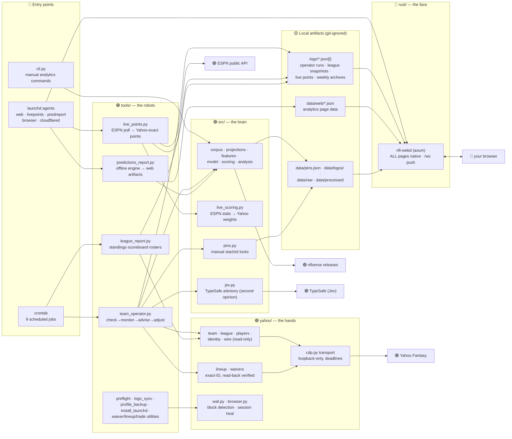

# Code guide — every file, explained

> Companion to the [README](../README.md) (what the system does) and the
> [architecture diagram](../README.md#architecture) (how the pieces connect).
> This guide explains **how each file is coded**: its functions, its
> invariants, and colored flowcharts of what happens inside.
> Written 2026-11-20 from a full independent review of the codebase.

## The five layers

| Doc | Covers | One-line role |
|---|---|---|
| [SRC_ENGINE.md](code/SRC_ENGINE.md) | `src/*.py` (16 files) | The Python brain: scoring, projections, win model, live scoring, pins |
| [YAHOO_LAYER.md](code/YAHOO_LAYER.md) | `yahoo/*.py` (13 files) | The hands: fail-closed CDP reads and exact-ID mutations of Yahoo |
| [TOOLS.md](code/TOOLS.md) | `cli.py` + `tools/*.py` (26 files) | The robots: cron/launchd entry points and manual utilities |
| [RUST_WEB.md](code/RUST_WEB.md) | `rust/src/*.rs` (8 files) | The face: one axum daemon serving every page from local artifacts |
| [RUST_WEB_ARCHITECTURE.md](RUST_WEB_ARCHITECTURE.md) | colored mermaid flowcharts of the Rust web daemon (request flow, Matchup, analytics, pins, live push) — the human-friendly view of the Rust code |
| [TESTS_INFRA.md](code/TESTS_INFRA.md) | `tests/`, `tools/launchd/`, CI, templates | The safety net: hermetic tests, launchd agents, templates |

## The one rule everything follows

**Robots compute and write artifacts; the web only reads artifacts.**
No web request ever touches Yahoo, ESPN, or pandas. Yahoo is read slowly
by cron jobs through one logged-in Chrome tab; ESPN is polled by the
live-points agent; the Python engine computes offline into `data/web/`;
nfl-webd serves all of it as millisecond file reads.

## Color legend (used in every chart below)

- 🔵 **blue** — inputs / data sources
- 🟢 **green** — functions / processing steps
- 🟡 **amber** — outputs / artifacts written to disk
- 🩷 **pink** — guards, decisions, fail-closed checks
- 🟣 **purple** — external systems (Yahoo, ESPN, nflverse, TypeSafe)
- 🩵 **teal** — entry points (CLI, cron, launchd, you)

## Whole-codebase map

## Suggested reading order

1. **New to the repo?** README → this map → [RUST_WEB.md](code/RUST_WEB.md)
   (what you see in the browser) → [TOOLS.md](code/TOOLS.md) (what runs on schedule).
2. **Working on projections/model?** [SRC_ENGINE.md](code/SRC_ENGINE.md)
   in order: config → ingest → corpus → scoring → projections → features → model.
3. **Working on Yahoo automation?** [YAHOO_LAYER.md](code/YAHOO_LAYER.md)
   in order: cdp → waf → browser → team → lineup/waivers, then the
   [TEAM_OPERATOR runbook](TEAM_OPERATOR.md) for operational contracts.
4. **Before changing anything:** [TESTS_INFRA.md](code/TESTS_INFRA.md) —
   the suite pins nearly every contract described in these docs.