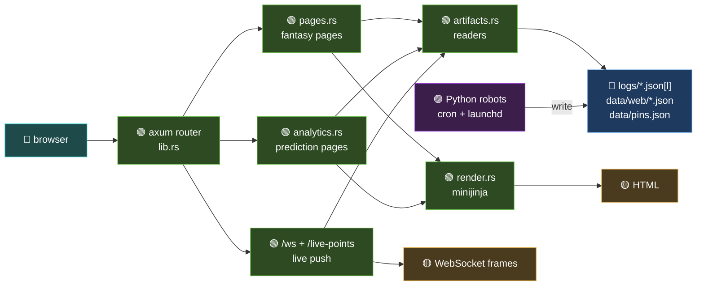
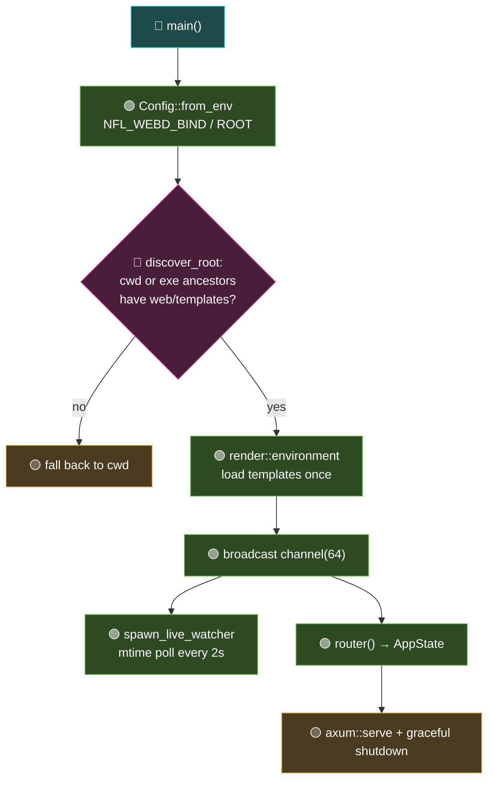
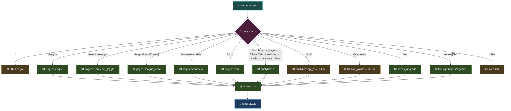
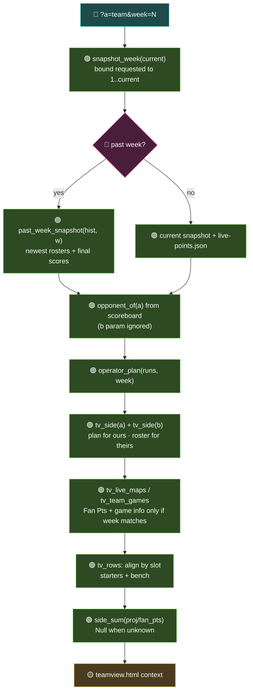
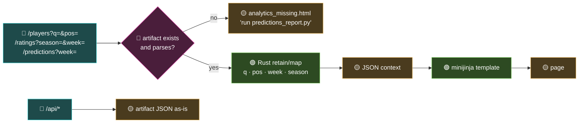
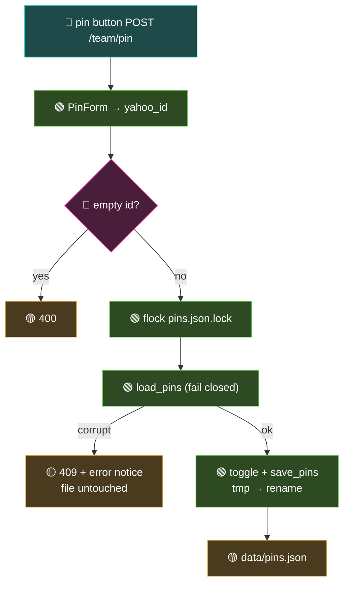
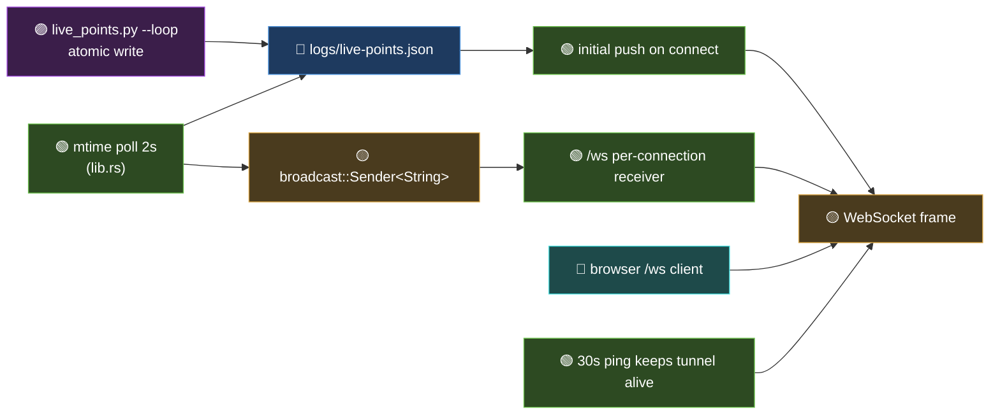

# nfl-webd — Rust web UI architecture

> Human-oriented companion to [RUST_WEB.md](code/RUST_WEB.md) (file-by-file
> reference). This document explains the **shape** of the Rust code: what
> each layer does, how a request flows, and where the refactor of
> 2026-11-24 simplified it. All charts use the shared color legend below.

Color legend:
- 🩵 **teal** — entry point (browser, route, launchd)
- 🟢 **green** — handler / function
- 🔵 **blue** — input data (local artifact, query param)
- 🟡 **amber** — output (rendered page, JSON, broadcast)
- 🩷 **pink** — guard / fail-closed decision
- 🟣 **purple** — external process (Python cron producer)

---

## 1. The one-sentence model

One loopback axum process (`nfl-webd`) reads local JSON artifacts that
Python robots wrote offline and renders every page with minijinja. No
request computes, calls Yahoo/ESPN, or waits on Python.

---

## 2. Startup and request path

`main.rs` binds the configured address, `Config::from_env()` discovers the
repo root, `router()` wires every route once, and `spawn_live_watcher`
polls `live-points.json` mtime every 2 s. Graceful shutdown on ctrl-c or
SIGTERM.

---

## 3. Every route → handler → artifact

The route table is declared in one place (`lib.rs::router`). Unknown paths
get a plain-text 404 — there is no upstream to proxy to.

---

## 4. Team View — the most involved page (after the 2026-11-24 refactor)

`teamview` used to be one 298-line function. It now reads top-to-bottom as
six plain steps; the two non-trivial decisions (past-week snapshot merge,
operator plan) are small named helpers. The opponent is always derived
from that week's scoreboard — no b parameter, no dropdown.

---

## 5. Analytics pages — the FD nation method

Each analytics handler is the same three lines of thought: read the
artifact, filter in Rust, render. Missing artifact → honest notice.
`side_sum`-style helpers keep the filtering obvious; no ORM, no query
builder, no request-time computation.

---

## 6. Pins — the fail-closed write path

`pins.rs` is a direct port of `src/pins.py`: same file, same shape, same
flock + atomic rename. A corrupt pin file is an error, never an empty set.
The web toggle returns 409 and re-renders the error instead of resetting
the user's protection.

---

## 7. Live updates — one file, one broadcast

The Python poller writes `live-points.json` atomically. The Rust watcher
notices the mtime change, broadcasts the file text, and each `/ws`
connection sends it to the browser. One artifact, one read path
(`artifacts::read_live_points_text`) shared by the HTTP endpoint, the
initial WebSocket push, and the parsed page readers.

---

## 8. What the 2026-11-24 refactor changed (and deliberately did not)

| Change | Why |
|---|---|
| `teamview` 298 → ~200 lines via `past_week_snapshot`, `operator_plan`, `side_sum` | three cohesive decisions got names; no new abstraction layer |
| `live-points.json` read in one place (`read_live_points_text`) | three callers had three slightly different behaviors |
| 3 bounded `unwrap()`s → `let Some ... else` / `match` | same behavior, no panic path to reason about |
| Doc comment updated to the schedule-locked opponent | docs described the removed b dropdown |

Deliberately **not** done: no traits for renderers, no generic artifact
cache, no new crate, no config DSL. Those would add indirection without
buying correctness for a daemon whose whole job is "read JSON, render
template".
