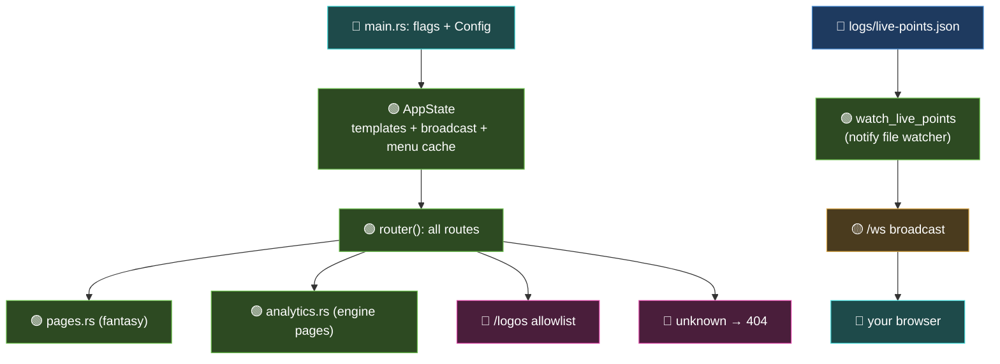
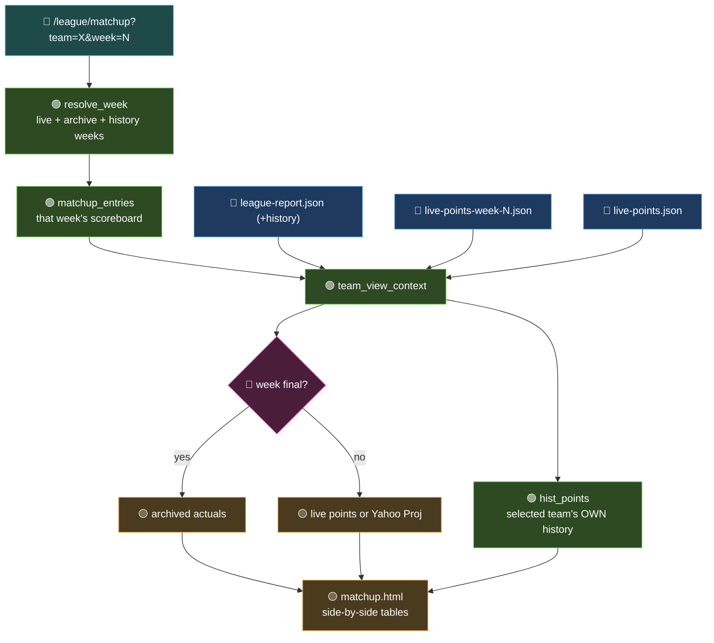
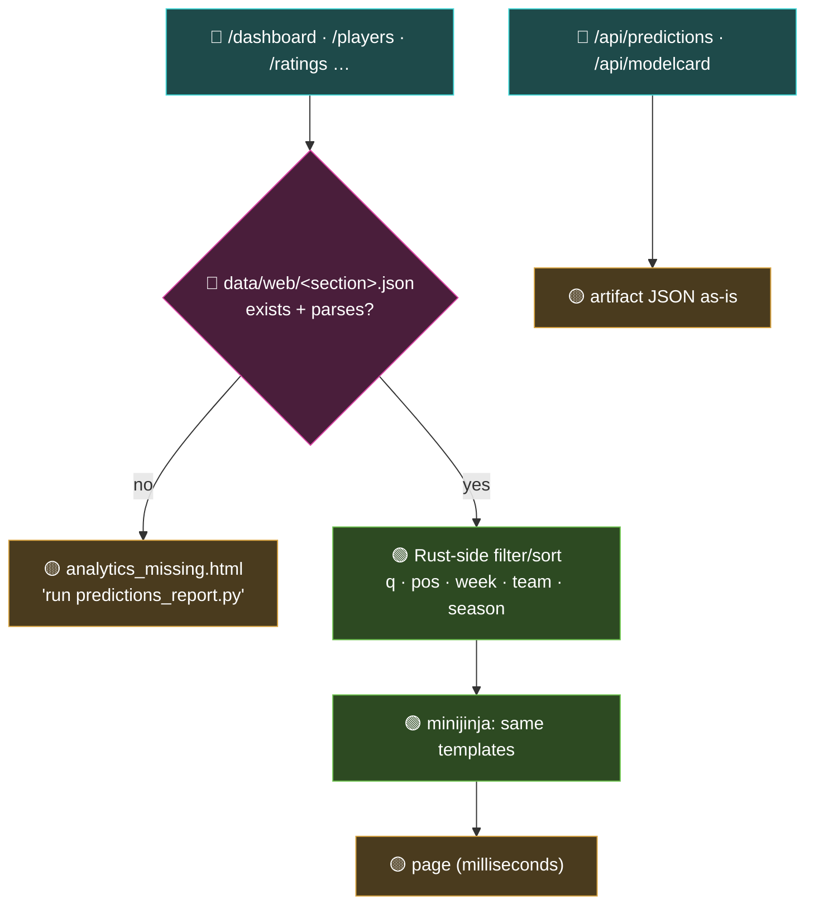
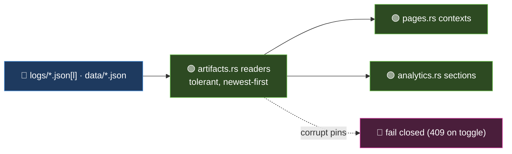

# rust/ — nfl-webd, the web daemon ("the face")

One axum process on 127.0.0.1:5000 serves **every** page natively with
minijinja over the shared `web/templates/`. No Flask, no proxy, no
request-time compute: handlers read local artifacts and filter in Rust.
8 source files, 38 tests. See the colored
[Rust web architecture guide](../RUST_WEB_ARCHITECTURE.md) for a
human-oriented flowchart of each layer.

Color legend: 🔵 input · 🟢 function · 🟡 output · 🩷 guard · 🟣 external · 🩵 entry.

---

## main.rs — the binary

`#[tokio::main]`: parse CLI flags (`--host/--port/--backend` removed →
host/port + template dir), build `Config` (repo root from the executable
path, `NFL_REPO_ROOT` override), start the live-points watcher, bind the
router, serve. `--repo-root`/env make tests and alternate checkouts work.

## lib.rs — wiring and shared state

- `Config` — repo_root, template_dir, data/logs paths, pins path.
- `AppState` — Config + minijinja `Environment` (templates loaded once) +
  the `/ws` broadcast channel + cached menu teams.
- `router()` — the route table:
  `/` → redirect `/league`; `/league`, `/team`, `/team/pin`,
  `/league/team/<name>`, `/league/matchup`, `/cron`, `/logos/<file>`,
  `/live-points`, `/ws`; analytics: `/dashboard`, `/players`,
  `/player/<id>`, `/predictions`, `/ratings`, `/strategy`, `/sos`,
  `/api/predictions`, `/api/modelcard`. Unknown → plain 404 (there is no
  upstream anymore).
- `watch_live_points()` — notify-based file watcher on
  `logs/live-points.json` → broadcasts the new payload to every WebSocket
  client (the League page's live updates).

---

## pages.rs — the fantasy pages

Handlers: `league`, `team`, `team_pin` (POST toggle), `league_team`,
`matchup`, `cron`, `logos`, `live_points`, `ws`.

- `league` — newest ok report (history fallback), standings/scoreboard/
  matchup context; the League home. Each matchup card is a Yahoo-`/matchup`
  hover-selectable target: a pure-CSS stretched link (`.mu-open`, absolute
  inset:0, z-index:1) makes the whole card clickable to `/league/matchup`;
  `:hover`/`:focus-within` give the grape-jelly highlight; team-name links
  stay above it (z-index:2) and still open the team page. See the colored
  [architecture chart](../RUST_WEB_ARCHITECTURE.md#4b-league-matchup-cards--hover-select-click-for-detail).
- `team` — operator runs + pins + roster fallbacks; the My Team operator
  view with pin buttons.
- `league_team` — any team's page: roster from the latest report
  (history fallback), Yahoo Proj Pts rendered or "—", never invented.
- `matchup` — **the GameChannel-style table**. Key functions:
  - `matchup_entries` — every week's scoreboard entries (live report +
    history), so the opponent dropdown is week-aware.
  - `week_options` / `resolve_week` — the week picker: live week + every
    week present in archives/history; explicit `?week=N` honored, else
    current.
  - `team_view_context` — builds the side-by-side tables: our snapshot
    roster vs the selected opponent; per-player **actual** points from
    the week archive (`live-points-week-N.json`) when final, else the
    live artifact, else Yahoo Proj; opponent points only where captured
    (never guessed).
  - `hist_points` — the selected team's OWN weekly actuals from history
    (the fix: other teams' history is theirs, not ours).
- `cron` — schedule + last-run status from the audit logs.
- `logos` — serves only files listed in `data/logos.json` (allowlist,
  traversal-proof).

---

## analytics.rs — the prediction-engine pages (native)

The Flask replacement. Every handler: read the section artifact from
`data/web/`, filter/sort in Rust, render the SAME templates the Flask app
used. Missing artifact → `analytics_missing.html` (honest notice naming
the producer command), never an error stack or fake data.

- `dashboard` — model metrics + top players + predictions preview.
- `players` — full board with `?q=` search + `?pos=` filter (Rust-side).
- `player` — per-player file `players/<id>.json` + weekly history table.
- `predictions` — week filter; `ratings` — season/week combo lookup;
  `strategy` — team/season splits; `sos` — ranking table.
- `api_predictions` / `api_modelcard` — JSON straight from artifacts.
- `read_section` — tolerant JSON read (missing/corrupt → None → notice).

---

## artifacts.rs — local artifact readers

The ONLY place the web layer touches disk state. Originally ported from
the retired Flask backend; the contract is unchanged: **read local
artifacts only, never live sources.**

- `read_operator_runs` — tail of `team-operator.jsonl`, newest first,
  tolerant of partial/corrupt lines.
- `read_league_report` — newest ok snapshot; falls back through history
  when the current file is missing/stale.
- `read_league_history` — the append-only `.jsonl` season history.
- `read_live_points` / `read_week_archive` — current artifact + weekly
  finals.
- `read_pins` / `read_logos` — state files (pins fail-closed on corrupt).
- All readers return `Option`/empty on absence — pages degrade to honest
  "no data yet" states, never 500s.

---

## pins.rs — the Rust pin store

Exact port of `src/pins.py` (same file, shape, fail-closed contract —
parity pinned by tests):
- `load_pins` — missing = empty; corrupt = `PinsError` → the toggle route
  answers **409** and the operator aborts before navigation.
- `toggle_pin` — flock on `data/pins.json.lock` (shared with the Python
  operator), atomic tmp+rename write, returns new state.
- The /team page's pin buttons POST here; `propose_lineup` consumes the
  same file on the next operator run.

---

## render.rs — template helpers

minijinja environment setup + the filters the templates rely on
(`fmt_pts`, `replace`, date/number formatting) — the compatibility layer
that let the Flask-era templates move over unchanged (one fix: Python
`str.replace()` calls became the `|replace` filter).

## tests.rs — the 38-test suite

Hermetic (temp dirs, fixture artifacts): pages render with real shapes,
pins parity with Python, logos allowlist + traversal rejection,
WebSocket push on artifact change, artifact-reader fallbacks, Matchup
week resolution + per-team history, analytics pages incl. missing-
artifact notices and filters. Run: `cargo test --lib`.