# src/ — the Python engine ("the brain")

Pure computation: no browser, no web framework. Everything here is either
fed by nflverse data (`data/raw/`) or by ESPN boxscores, and everything
writes results that the robots persist as artifacts. 16 files.

Color legend: 🔵 input · 🟢 function · 🟡 output · 🩷 guard · 🟣 external · 🩵 entry.

---

## config.py — constants and scoring presets

The single source of truth for seasons and weights. No computation.

- `SCHEDULE_SEASON = 2026`, `STATS_SEASON = 2026` — the "current" year.
- `HISTORY_SEASONS = (2022..2026)` — projection baseline window.
- `PBP_SEASONS = (2022..2026)` — play-by-play availability (drives the
  leakage guards in features.py).
- `STANDARD_SCORING` — reverse-engineered from nflverse's own shipped
  `fantasy_points` column via least squares (R²=1.000): INT −2, every
  fumble lost −2, 2pt +2. `PPR_SCORING` / `HALF_PPR_SCORING` add receptions.
- `FD_NATION_SCORING` — half-PPR with INT −1 (the live Yahoo league
  setting). `DEFAULT_PRESET = "fd-nation"`.
- `league_preset()` — reads `FP_SCORING` (env or `.env`, parsed without
  mutating os.environ) → preset key. `typesafe_api_key()` — same pattern
  for the Jev key. **Secrets never live in code.**
- `SKILL_POSITIONS = (QB, RB, WR, TE)` — what we project.

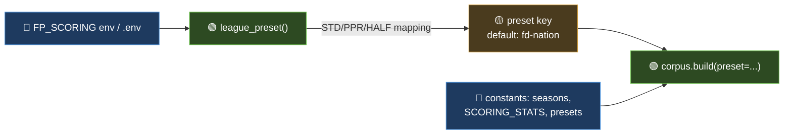

> Note: for **live** points the authoritative weights are
> `data/league-scoring.json` (captured from Yahoo's settings page), not
> these presets — presets are for planning, captured settings for realtime.

---

## ingest.py — nflverse downloads and loaders

All network access to nflverse lives here. Crash-safe downloads, lazy
caching under `data/raw/`.

- `_stream_to(url, dest)` — streams via a `.part` file then renames: a
  crash never leaves a half-file that later loads as "valid".
- `download_asset(tag, filename)` / `download(name)` / `load(name)` —
  fetch-if-missing then return a DataFrame. `load_all()` — core datasets.
- `load_pbp(season)` — play-by-play (~95 MB/season), the strategy source.
- `load_schedule(season)`, `load_depth_charts(season)`,
  `load_injuries(season)` (falls back one season if unpublished),
  `load_draft_picks()`, `load_team_stats()`.
- `collect_corpus()` — everything the projection corpus needs.

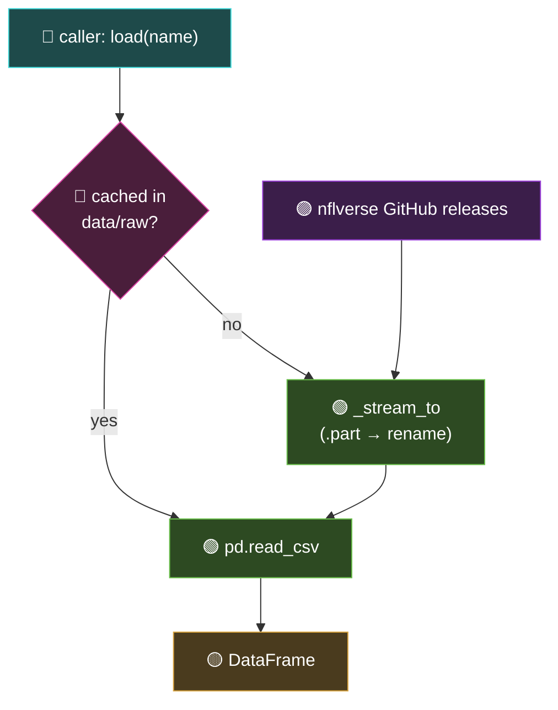

---

## corpus.py — assemble the projection corpus

Turns raw tables into the tidy dict every projection call consumes.
Scoring is **baked in here** (weekly_history is scored with the preset),
so downstream functions never take a preset argument.

- `_weekly_history()` — stack 2022–2026 regular-season weekly stats with
  season tags + `fantasy_points`.
- `build_team_defense()` — points allowed per team from the games table;
  drops unplayed (NaN-score) games; derives `def_sos_factor`.
- `build_schedule_2026()` — each team's weekly opponent, home/away,
  kickoff fields preserved (week awareness, #83).
- `build_depth_roles()` — 2026 depth-chart role shares for skill positions.
- `build(preset)` — returns `{weekly_history, players, schedule_2026,
  depth_roles, team_defense, injuries?}`.

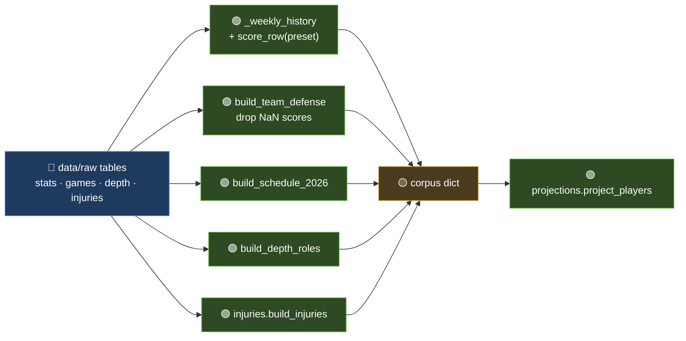

---

## scoring.py — fantasy points from stat lines

- `score_row(row, scoring)` — one player's stat line × weights.
- `add_scores(df, scoring)` — adds `fantasy_points` column.
- `rank_players(df)` / `weekly_rankings(df, week)` — season/week boards.
- `validate_against_nflverse(df)` — recomputes and compares against
  nflverse's shipped columns; max delta 0.00 across presets (the generic
  presets keep INT −2 so this comparison stays like-for-like).

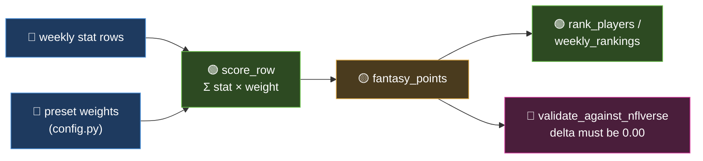

---

## lineup.py — greedy lineup optimizer

- `LINEUP_TEMPLATE` — 1QB/2RB/2WR/1TE/1FLEX(RB/WR/TE)/1K/1DEF, exactly the
  FD nation roster slots.
- `optimize_lineup(ranked)` — fills slots greedily from a scored table,
  best available first, one skill player into FLEX. **Honesty rule:** if
  no eligible player actually scores (K/DEF in the nflverse *player*
  table are 0), the slot stays empty — never a fabricated 0-point pick.
- `lineup_total(lineup)` — sum of chosen points.
- A heuristic, not an ILP solver (documented limitation). The Yahoo-aware
  recommender (`yahoo/recommend.py`) is what the operator actually uses.

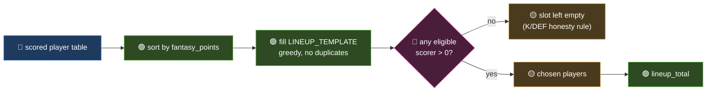

---

## projections.py — the 2026 projection engine

Five transparent steps, no black box (`project_players`):

1. **Weighted baseline** — per-game mean over games actually played,
   seasons weighted 1.0/1.5/2.0/2.5/3.0 (2026 pulls hardest). Grouped by
   `player_id` only — position relabeling must not duplicate players (#112).
2. **Rookie prior** — draft-class players with no history are injected
   with games=0 (confidence 0 → exactly the position mean), then discounted
   by draft capital (round 1 ×1.10, round 2 ×0.90, later ×0.75).
3. **Regression** — blend baseline with position mean by
   `conf = min(games/20, 1)`.
4. **Role** — × depth-chart `role_share / 0.60` (unranked = 0.15).
5. **SOS + availability** — × (1 + mean opponent `def_sos_factor`), floor
   at 0; totals × `expected_games = 17 × (0.5 + 0.5 × availability)`.
   The current season's denominator counts **weeks elapsed**, not 17 —
   one 2026 appearance must not price a durable starter below an inactive one.

`project_for_week(corpus, week)` — strips season SOS, re-applies that
week's opponent SOS, zeroes bye players (`_mark_byes`), and multiplies by
`injuries.penalty_factor(status)` when the corpus carries injuries.

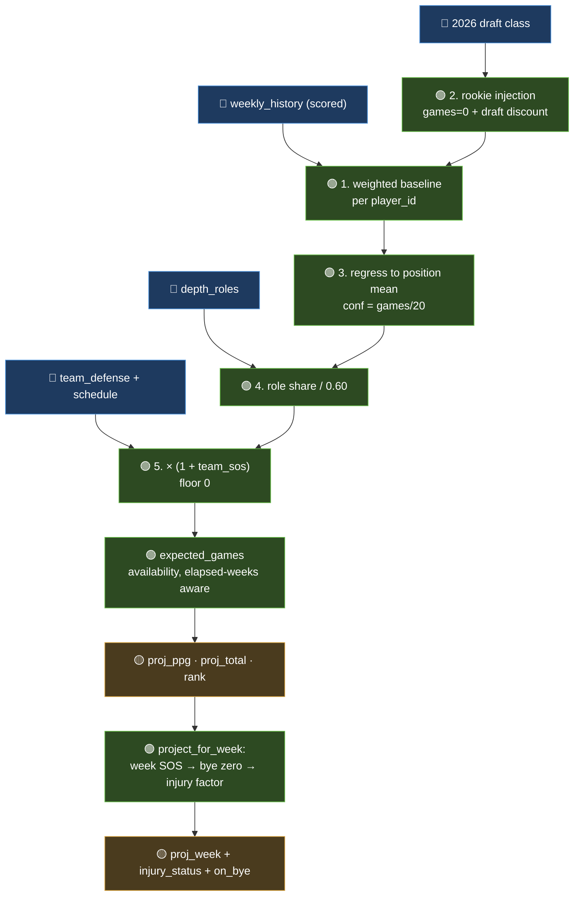

---

## features.py — leakage-safe PBP feature engineering

The rigor layer. Every rating is **as-of** a (season, week): only weeks
1..W−1 of that season; week 1 uses the strictly-prior season.

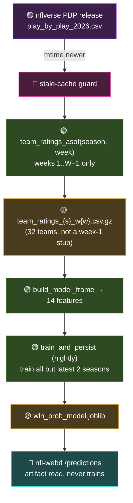

- `_offense_plays(pbp)` — real pass/run plays with valid EPA.
- `_team_efficiency_from_plays(plays)` — offense grouped by `posteam`,
  defense by `defteam`: EPA/play, success, red-zone TD rate, 3rd-down EPA,
  pass/rush splits.
- `prior_season(season)` — pure function: newest PBP season strictly
  before `season`, else **None**. The #17 leakage guard: callers must drop
  the game, never substitute a newer season.
- `team_ratings_asof(season, week, refresh)` — cached to
  `data/processed/team_ratings_{season}_w{week}.csv.gz`; empty results are
  deliberately NOT cached; unpublished seasons return empty without any
  network call (`_load_pbp_or_empty` checks membership first). A cache whose
  PBP source has a newer mtime is rebuilt automatically, so a mid-season PBP
  refresh cannot leave week-1-stub ratings in place all season.
- `game_feature_row(rt, home, away, rests)` — the 14 features, **shared by
  training and inference** so they can never drift (#18). None when a team
  is unrated → caller skips the game.
- `build_model_frame(seasons)` — labeled game rows; drops unplayed games
  (NaN scores) and ties (#28 — a tie is not a home loss); memoizes ratings
  per (season, week) (#24: 1,087 games → ~72 lookups).
- `strategy_breakdown(pbp, team)` — situation splits for the Strategy page;
  empty split → None (JSON null, never NaN).

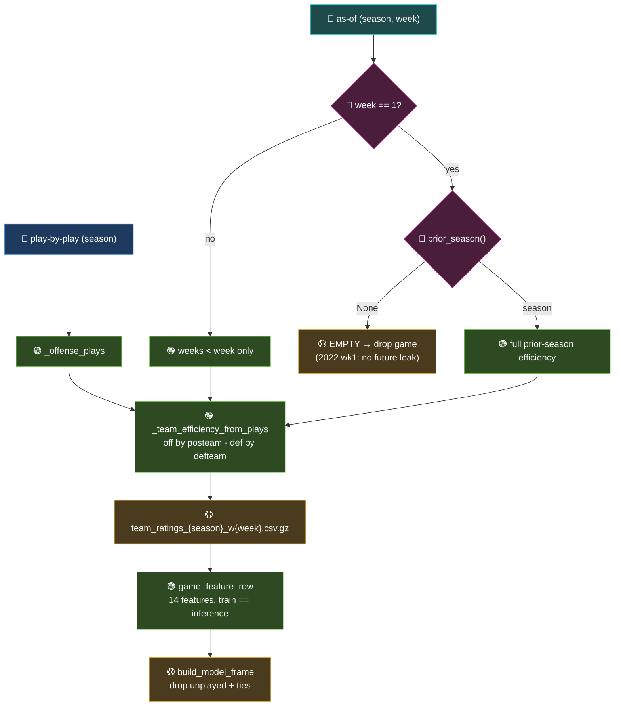

---

## model.py — calibrated win-probability model

- `_make_estimator()` — StandardScaler → LogisticRegression, wrapped in
  `CalibratedClassifierCV` (Platt/sigmoid, cv=5).
- `train_and_persist(seasons)` — fits **two variants** on the same
  leakage-safe features: `no_spread` (14 EPA/rest features) and
  `with_spread` (+ Vegas line). Saves the bundle to
  `data/processed/win_prob_model.joblib`, stamped with `sklearn_version`.
- `load_model()` — memoized; `_validate_bundle` rejects wrong-shape
  artifacts; `_replay_load_warnings` collapses ~50 duplicate
  InconsistentVersionWarnings into one precise version-skew warning.
  Cross-version pickles are flagged loudly — **retrain after sklearn
  upgrades** (`train_and_persist()`).
- `train_and_evaluate(train, test)` — strict time split; accuracy /
  log-loss / Brier for both variants + Vegas-favorite baseline. The producer
  picks train/test data-driven from `PBP_SEASONS` (two latest = holdout).
- `time_series_cv(seasons)` — expanding window, each season tested on all
  prior ones (min 50 rows per side). Includes the current in-season fold.
- `predict_2026(week)` — per-week as-of ratings; with_spread when the line
  is published, else no_spread; every row tagged with its `model`.
  Uncomputable weeks are skipped with a loud warning (never scored on
  stale knowledge); if nothing is computable it raises. Missing artifact →
  `_linear_fallback` rows tagged `fallback_linear` — never mistaken for
  the real model.

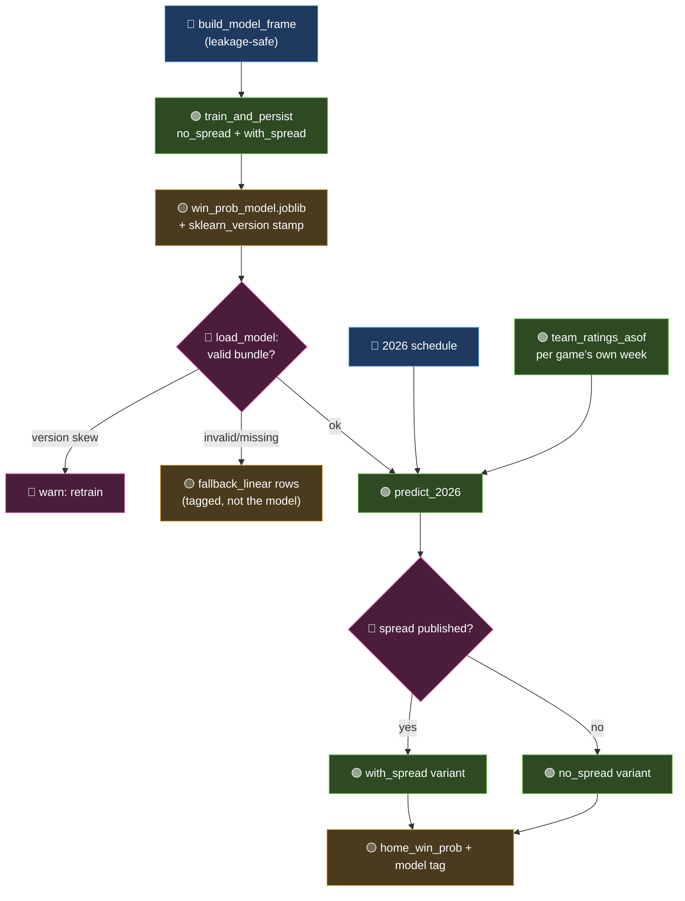

---

## live_scoring.py — ESPN stats → exact Yahoo points

The realtime engine. Converts one ESPN boxscore into fantasy points under
the **captured** Yahoo weights (`data/league-scoring.json`), including the
tricky bits the boxscore doesn't carry directly.

- `load_scoring()` — the authoritative weights table.
- `norm_name(name)` — ESPN↔Yahoo name matching (case, suffixes Jr./Sr./III).
- `parse_game(summary)` — flattens an ESPN summary into player stat lines
  + team context; `_num` parses cells like "23/33" → 23, "-" → 0.
- `offense_points(stats, weights)` — passing/rushing/receiving under the
  weights (INT −1, 0.5 PPR, fumbles lost −2…).
- `kicker_points` / `fg_tier_points` — FG **distance tiers from scoring
  plays** (the boxscore lacks distances) + XPs.
- `def_points` — team DEF/ST: points-allowed tiers, sacks, INTs, fumble
  recoveries, safeties, blocked kicks, return TDs.
- `play_extras` — attributes scoring-play events the boxscore misses
  (2-point conversions hide in TD-play parentheticals).
- `compute_game(summary)` — `{norm_name | "DEF:<abbr>": points}`.
- `def_key_for(name, abbr)` — matches a Yahoo DEF entry ("Steelers", "Pit")
  to an ESPN abbr.

Accuracy is frozen by `tests/test_live_scoring.py`: 15/15 roster players
exact to 0.01 against Yahoo's own week-10 finals.

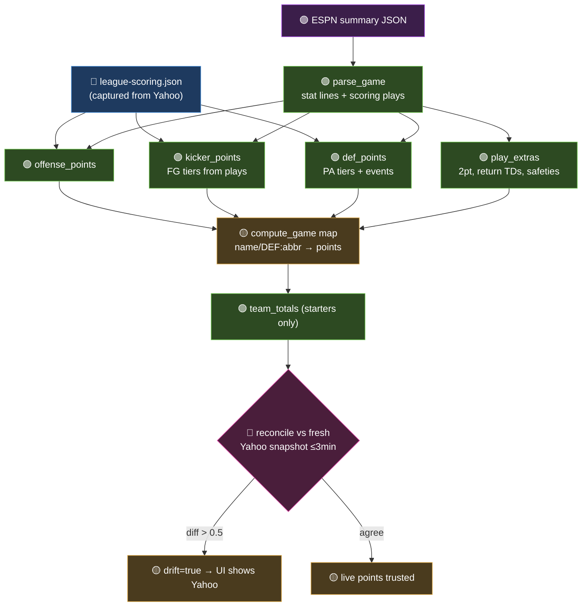

---

## pins.py — manual start/sit locks

The user's judgment outranks the robot. Shared contract with the Rust
port (`rust/src/pins.rs`): same file, same shape, same fail-closed rules.

- Shape: `{"pinned": {"<yahoo_id>": {"name", "pinned_at"}}}` in
  `data/pins.json`.
- `load_pins()` — missing file = no pins; unreadable/corrupt = `PinsError`
  (the operator aborts with `pins_error` **before any Yahoo navigation**;
  the web refuses toggles with 409).
- `save_pins()` — atomic tmp+rename; readers never see partial writes.
- `toggle_pin(id, name)` — flock-serialized flip; returns the new state.
- `pinned_ids()` — what `propose_lineup` consumes: a pinned player keeps
  his CURRENT slot (like a game-locked player); other slots still optimize.

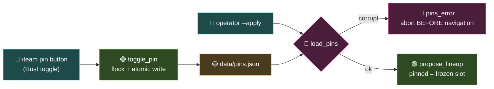

---

## schedule.py — week and kickoff awareness

- `kickoff_utc(gameday, gametime)` — nflverse ET strings → UTC.
- `with_kickoffs(schedule)` — adds `kickoff_utc`.
- `current_week()` — the REG week in progress (or next up).
- `lock_times(week)` / `locked_teams(week)` — team → kickoff; teams already
  kicked off (their players are locked in Yahoo).
- `earliest_kickoff(week)` — the cron lineup deadline.

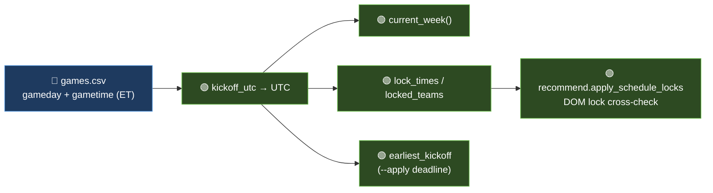

---

## injuries.py — injury awareness

- `_latest_injury_file()` / `load_injury_flags()` — newest usable nflverse
  injuries CSV → `{gsis_id: report_status}`.
- `build_injuries()` — corpus table `player_id + injury_status`.
- `penalty_factor(status)` — Out/IR → 0.0 (unstartable), Doubtful heavily
  discounted, Questionable lightly, healthy 1.0. Consumed by
  `project_for_week`.

---

## analysis.py — consistency, SOS, matchup boards

- `consistency(history)` — per-player CV, boom/bust rates (weekly floor/
  ceiling behavior).
- `sos_ranking(corpus)` — 2026 team SOS from opponents' points allowed
  (easier = higher); feeds the SOS page.
- `weekly_matchups(corpus, week)` — start/sit board: each skill player vs
  that week's opponent defense.

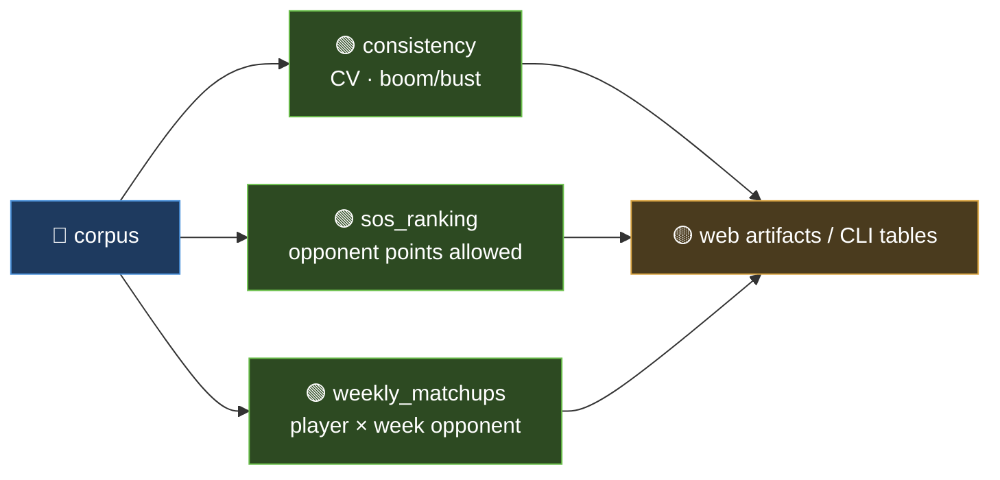

---

## backtest.py — leakage-controlled projection backtests

- `project_historical_season(target_season)` — projects returning players
  using **only earlier seasons' rows** (the same pipeline, time-shifted).
- `backtest_metrics(...)` — Spearman rank correlation, PPG MAE, positional
  top-N recall vs realized points; `BacktestMetric.as_dict` for reports.
- Results published in [PROJECTION_BACKTEST.md](../PROJECTION_BACKTEST.md).

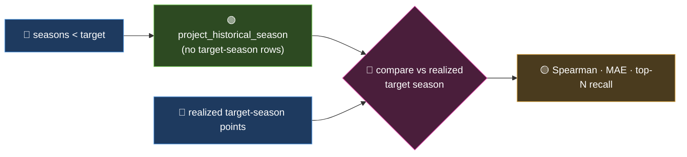

---

## jev.py — TypeSafe "System One" advisory layer

A **second opinion**, never a source of truth: Jev has no live NFL
knowledge — it judges only the projections/statuses we put into the state.
Fail-soft everywhere: a Jev outage never changes an operator run's status.

- Question primitives: `noul` (yes/no probability), `choice` (pick one),
  `score` (ordered levels). `connect()` / `ask()` — one SDK request
  evaluates all questions against a state snapshot; typed `JevAnswer`s.
- `waiver_state` / `waiver_questions` / `review_waiver_targets` — advisory
  `jev` block per wire target (profile/claim/risk).
- `injury_state` / `injury_questions` / `review_injured_players` — triage
  for Q/D/O roster players.
- `trade_state` / `trade_questions` / `judge_trade` — structured trade
  verdict (accept/roughly_fair/reject + fairness + risk), numbers from our
  season projections.
- Key from `TYPESAFE_API_KEY` (env/.env). `JevError` = never guess.

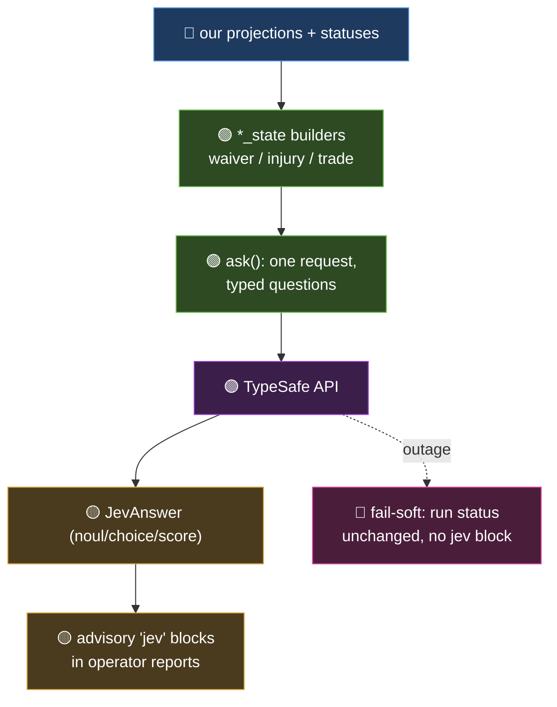