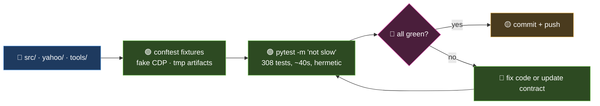
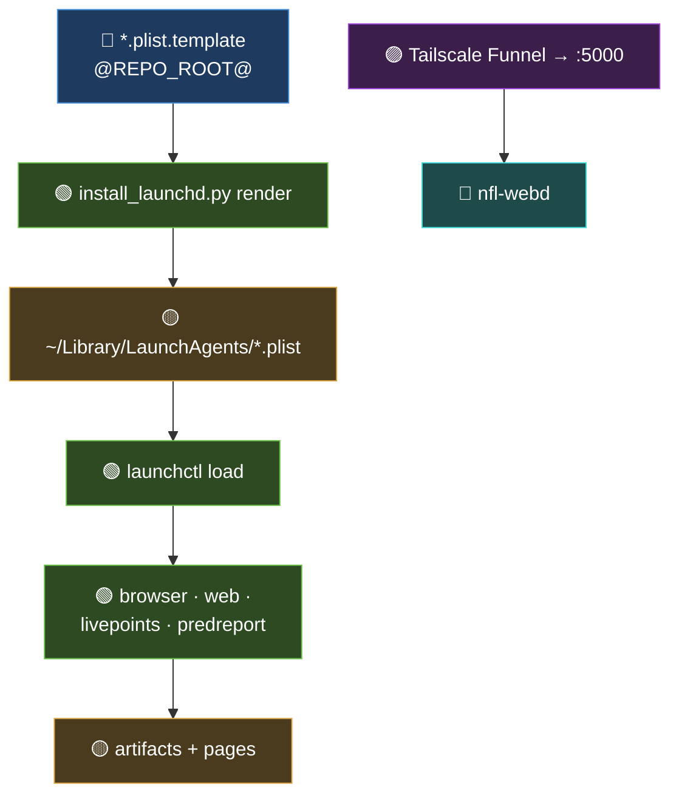

# tests/, launchd, CI, templates — the safety net

The suite pins nearly every contract described in the layer docs:
fail-closed behavior, exact-ID mutations, leakage guards, scoring
accuracy, artifact shapes. **308 fast Python tests + 29 Rust tests**,
hermetic-first (no network, no browser, no Yahoo in the fast suite).

Color legend: 🔵 input · 🟢 function · 🟡 output · 🩷 guard · 🟣 external · 🩵 entry.

---

## The Python suite (tests/, 36 files)

Run: `.venv/bin/python -m pytest -m "not slow"` (~40s).
Slow/live-marked tests are deselected by default.

| Area | Files | What is pinned |
|---|---|---|
| Engine math | `test_scoring`, `test_projection_logic`, `test_projections`, `test_corpus`, `test_features`, `test_model`, `test_backtest`, `test_injuries`, `test_schedule`, `test_bye_weeks` | weights vs nflverse (delta 0.00), as-of leakage guards, rookie priors, bye zeroing, injury factors, time-split evaluation, fallback tagging |
| Live accuracy | `test_live_scoring`, `test_league_scoring`, `test_live_points` | **15/15 week-10 finals exact to 0.01** on real fixtures; 2pt/FG-tier/DEF edges; signature gating + reconciliation |
| Yahoo contracts | `test_yahoo_team`, `test_yahoo_league`, `test_league_parse`, `test_yahoo_lineup`, `test_yahoo_waivers`, `test_yahoo_identity`, `test_yahoo_recommend`, `test_wire_scan` | identity fail-closed, locked-row parsing, exact-ID preconditions + read-back, no-POST-replay, WAF aborts, unique-name reconciliation |
| Robots | `test_team_operator`, `test_league_report`, `test_team_analyzer`, `test_weekly_lineup`, `test_preflight`, `test_verify_relaunch`, `test_logo_sync`, `test_trade_check`, `test_jev` | pins-before-navigation, flock skip, waf_blocked status, atomic writes, merge keeps rosters, drill verdicts, fail-soft Jev |
| Infra | `test_launchd_agents`, `test_pins`, `test_predictions_report`, `test_browser` | plist rendering/paths, pin parity + fail-closed, artifact shapes + JSON safety + fail-soft sections, profile backup/restore |

`conftest.py` provides the shared fixtures (fake CDP clients, fixture
artifacts, tmp repo roots). The design rule: **a contract change must
change a test first** — the suite is the executable specification.

---

## The Rust suite (rust/src/tests.rs, 41 tests)

Run: `cd rust && cargo test --lib`. Hermetic: temp-dir repo roots with
fixture artifacts. Covers page rendering shapes, pins parity with the
Python store, logos allowlist + path-traversal rejection, WebSocket push
on artifact change, reader fallbacks, Matchup week resolution and
per-team history, analytics pages (filters + missing-artifact notices).

---

## launchd agents (tools/launchd/)

Four agents, all rendered by `tools/install_launchd.py` (`@REPO_ROOT@`
substitution; **reinstall after any repo move** — plists embed absolute
paths):

| Agent | Runs | Schedule |
|---|---|---|
| `com.fdnation.browser` | keeps the logged-in Chrome alive | at load + KeepAlive |
| `com.fdnation.web` | nfl-webd, ALL pages | KeepAlive, logs/web.log |
| `com.fdnation.livepoints` | ESPN poller `--loop` | KeepAlive |
| `com.fdnation.predreport` | offline analytics producer | daily 06:12 JST + Wed 21:05 |

The retired `com.fdnation.backend` (Flask :5001) and `com.fdnation.cloudflared`
(quick tunnel) were removed with the Rust migration and the Tailscale Funnel
switch. Public HTTPS is now `tailscale funnel --bg 5000` (tailscaled state,
not a launchd agent). The 9 crontab jobs (operator runs, league reports,
profile backup) are documented in the README's schedule table.

---

## CI (.github/workflows/ci.yml)

GitHub Actions on push/PR: Python setup, dependency install, the fast
pytest suite. The Rust suite runs locally via cargo (the daemon is
built with `cargo build --release` before installing the web agent).

## web/templates/ (15 templates, shared by the Rust renderer)

- `layout.html` — the shell: top menu (League · My Team · Cron, plain links),
  shared CSS, the `/ws` client script.
- `team_picker.html` — partial: on-page "Viewing team" dropdown included in
  `team.html` and `league_team.html` (never in the top menu).
- Fantasy: `league.html`, `team.html` (pin buttons), `league_team.html`,
  `matchup.html` (side-by-side GameChannel tables + week/opponent
  pickers), `cron.html`.
- Analytics: `dashboard.html`, `players.html`, `player.html`,
  `predictions.html`, `ratings.html`, `strategy.html`, `sos.html`,
  `analytics_missing.html` (the honest "run the producer" notice).
- minijinja renders these unchanged except one filter fix
  (`|replace` instead of Python's `.replace()` method call).

## Where state lives (quick reference)

| Path | Written by | Read by |
|---|---|---|
| `data/raw/`, `data/processed/` | ingest, features, model | engine |
| `data/web/*.json` | predictions_report | analytics pages |
| `data/pins.json` (+`.lock`) | web toggle + operator | operator, /team |
| `data/logos/` + `logos.json` | logo_sync | /logos, league pages |
| `data/league-scoring.json` | captured Yahoo settings | live_scoring |
| `logs/team-operator.jsonl` | team_operator | /team, /cron |
| `logs/league-report.json` + `.jsonl` | league_report | league pages, Matchup history |
| `logs/live-points.json` | live_points | /ws push, League |
| `logs/live-points-week-N.json` | live_points archive | Matchup past weeks |
