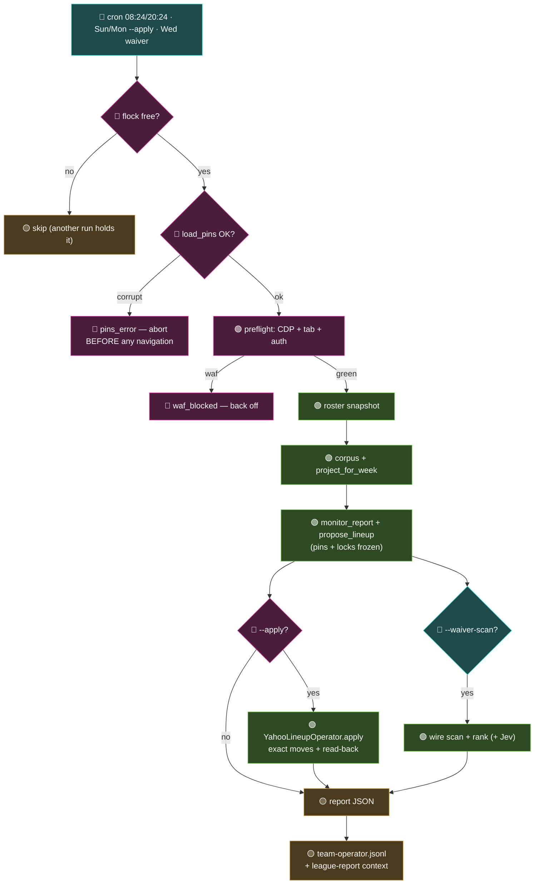
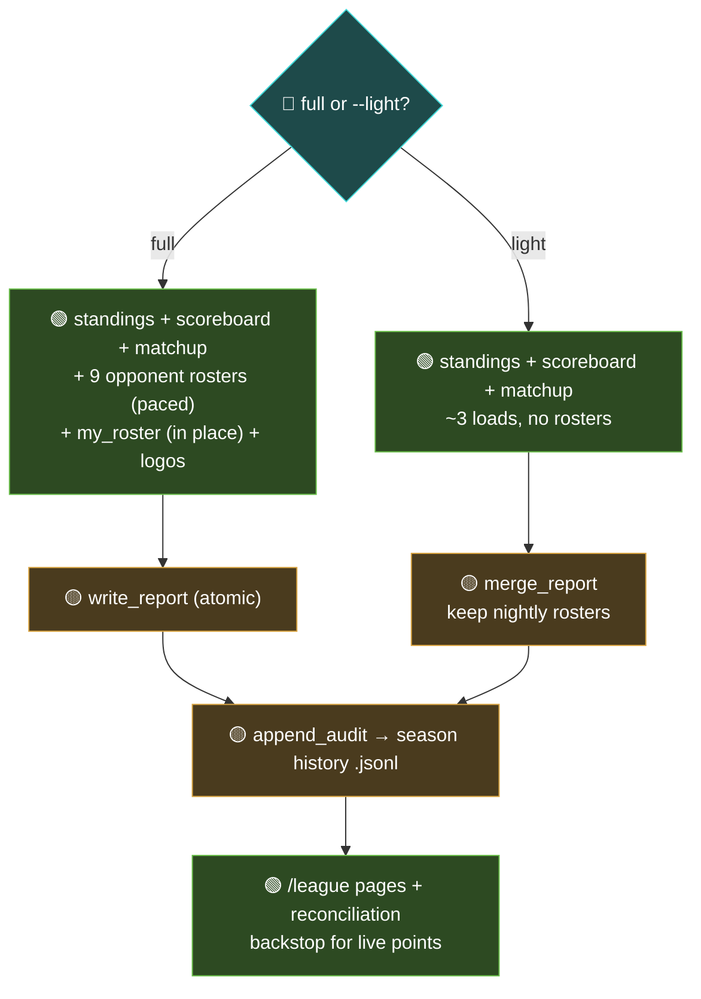
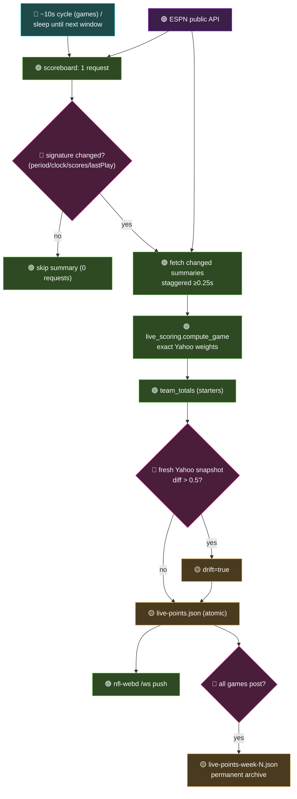
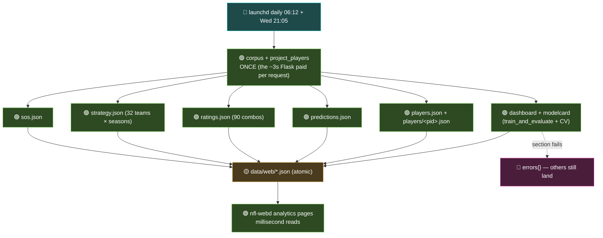
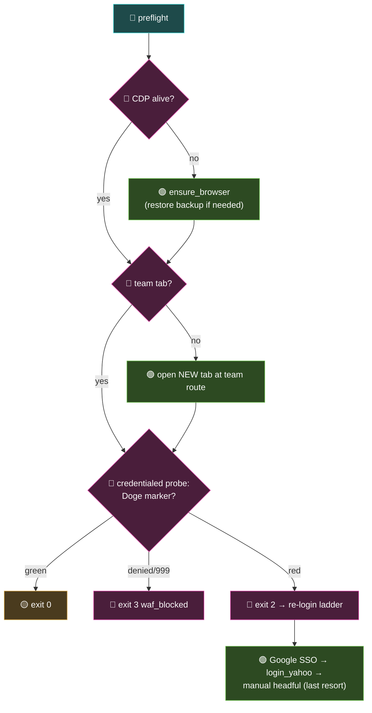
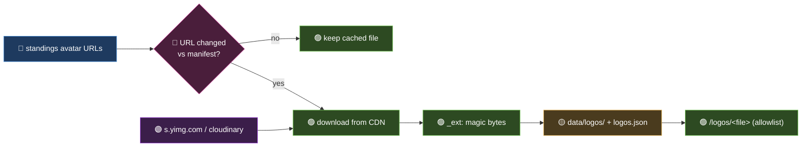

# cli.py + tools/ — the robots and utilities

Entry points: what cron/launchd run on schedule, and what you run by hand.
Every Yahoo-touching tool here composes the `yahoo/` layer and obeys its
safety contracts; every artifact write is atomic (tmp + rename).

Color legend: 🔵 input · 🟢 function · 🟡 output · 🩷 guard · 🟣 external · 🩵 entry.

---

## cli.py — the analytics CLI

Manual access to the engine (no Yahoo, no web). Subcommands map 1:1 to
`src/` functions:

| Command | Does |
|---|---|
| `ingest [--refresh]` | download/cache nflverse data |
| `schedule` | print the 2026 schedule |
| `rank` / `week N` | season / single-week scoring boards (`--preset`, `--top`) |
| `lineup` | greedy optimizer over a scored table |
| `validate` | our scoring vs nflverse's shipped columns |
| `corpus` | assemble the full projection corpus |
| `projections` / `consistency` / `matchups N` / `sos` | the projection engine outputs |
| `predict [week]` | 2026 win probabilities (skips uncomputable weeks loudly) |

`--season` overrides the stats year where supported. The old `web`
subcommand is gone — the web UI is Rust now.

---

## team_operator.py — THE in-season entry point ⭐

The cron workhorse: **check → monitor → advise → adjust → report**, one
JSON report + one audit line per run.

- `run()` sequence: flock (`logs/team-operator.lock`, non-blocking —
  overlapping runs skip) → **pins load FIRST** (corrupt = `pins_error`
  before any Yahoo navigation) → preflight (browser/session heal) →
  authoritative roster snapshot → corpus + current-week projections →
  `monitor_report` + `propose_lineup` (pins/locks frozen) → matchup
  context → optional `--waiver-scan` (rank only, never auto-claim) →
  optional `--jev N` advisory blocks (fail-soft) → report.
- `--apply` submits ONLY the recommended lineup moves via the verified
  lineup operator; refuses when `--week` disagrees with Yahoo's week.
- WAF block → `status: waf_blocked`, abort, skip tab restore.
- `_audit()` appends to `logs/team-operator.jsonl` (the web's /team and
  /cron pages read this).

---

## league_report.py — the league snapshot robot

Nightly `--all-rosters` (21:19) + game-day `--light` (:05/:35).

- Full: standings + scoreboard + matchup + **all 10 rosters** (9 paced
  opponent reads with `--roster-delay` 3s + 2s settle; our own via
  `my_roster()` in place — zero extra navigation) + logo sync.
- Light: standings + full-week scoreboard + our matchup (~3 page loads,
  no roster reads). `merge_report()` refreshes the snapshot **without
  dropping the nightly rosters**.
- `write_report()` atomic; `append_audit()` adds one line to the season
  history `league-report.jsonl` (Matchup's past weeks read it).
- WAF → exit 2 + `waf_blocked`, restore skipped.

---

## live_points.py — the realtime points poller ⭐

launchd `com.fdnation.livepoints`, `--loop`. ESPN-only (zero Yahoo
requests → zero WAF risk). Polite by construction:

- `scoreboard()` — ONE request per cycle; `game_signature()` (period,
  clock, scores, lastPlay.id) decides which summaries changed;
  `fetch_json` re-fetches only those, staggered ≥0.25s; stopped clocks
  cost zero summary requests; forced sweep every ~60s catches stat
  corrections; final games fetched once and cached.
- `compute_week()` — `live_scoring.compute_game` per game → player/DEF
  points; `load_rosters()` reads the LOCAL Yahoo snapshot (never live);
  `team_totals()` sums starters only.
- `reconcile()` — vs a FRESH (≤3 min) light-cron snapshot; diff > 0.5 →
  `drift=true` (UI shows Yahoo's verified number).
- `write_artifact()` atomic → `logs/live-points.json` (nfl-webd watches
  and pushes over /ws).
- `archive_if_final()` — when every game is `post`, persist
  `logs/live-points-week-N.json` permanently (rewritten only on content
  change). This is the history Matchup browses.
- `loop()` — ~10s cycles during games (`clamp_interval` floor 5s),
  sleeps between windows (`_next_window` from the schedule).
- `--week N --out path` — backtest any finished week from ESPN.

---

## predictions_report.py — the offline analytics producer ⭐

launchd `com.fdnation.predreport` (daily 06:12 JST + Wed 21:05 after the
waiver/data refresh). The FD nation method for the prediction engine:
compute once, serve forever.

- `build_all(out)` — shared corpus + projections computed ONCE, then
  sections: dashboard (top-15 + model evaluation), modelcard, players
  (full board + per-player history files), predictions (all computable
  weeks), ratings (every season × week 1–18 combo), strategy (all teams ×
  all PBP seasons), sos.
- **Fail-soft per section**: one failure never blocks the others; the
  summary lists errors, exit 1 if any.
- `records(df)` — `df.to_json` round-trip: numpy scalars + NaN → valid
  JSON (null), never `NaN` tokens. `write_json` atomic.
- Output `data/web/*.json` → the Rust analytics pages are pure reads.

---

## The session-health family

### preflight.py
The chain every operator trusts: CDP alive → team tab present (opens a
NEW tab when none — never navigates a tab it didn't create) → credentialed
auth probe (`/f1/1329011/team/002` fetch, Doge marker). Exit codes:
**0** green · **2** auth red/other failure · **3** `waf_blocked` (back
off, do NOT re-login). `_probe_flags` distinguishes denial body / HTTP
999 from a real logout.

### launch_browser.py / edge_alive.py / check_login.py / recover_tab.py
One-shot utilities: idempotent CDP launcher; liveness probe; definitive
session check; tab recovery to the team route.

### login_yahoo.py
Native Yahoo login over CDP (human-like typing/clicks via `type_text`,
`click_center`, `click_label`); stops with `CAPTCHA_BLOCKED` when a
captcha appears — never fights it. Credentials from `.env`, never code.

### profile_backup.py
Cron Sun 09:37: snapshot the browser profile (cookies + saved logins) to
`~/edge-profile-backups/`; `--stop-browser` for a consistent snapshot +
auto relaunch; `--restore` to bring it back. Local file copy — no Yahoo
requests.

### verify_relaunch.py
The session drill: copy the profile (or its backup) to a throwaway dir,
launch a headless instance on a spare port (`check_port_free` refuses
collisions with the live browser), run the canonical signed-in probe,
clean up. Exit 0 = relaunch comes back logged in; 1 = session dead
(positive evidence); 2 = inconclusive (WAF/infra). The live browser is
never touched.

---

## The decision-support family

### team_analyzer.py
Manual "is my team good, what needs doing": pulls every league roster
live, maps to projections, reports strength rank, position ranks, alerts
(locks/injuries/byes), ranked recommendations. `--light` = ~5 reads (my
roster + standings + matchup only); `--no-wire` skips the scan; `--json`
machine-readable. WAF aborts the scan instantly (skipped section, never
a crash).

### weekly_lineup.py
Computes the optimal weekly permutation from live roster + our
projections (`_derive_on_bye` from the schedule), optionally applies via
the verified operator; audits like team_operator.

### yahoo_lineup.py / yahoo_waiver.py / yahoo_team.py
Thin CLIs over the operators: `--move id:from:to` (dry-run default,
`--apply` submits), `--add-id/--drop-id` (prepare default), read-only
roster print. All the safety lives in `yahoo/lineup.py` / `waivers.py`.

### yahoo_identity_map.py
Rebuilds `logs/yahoo-player-map.json` (read-only reconciliation report).
Run before recommendations/mutations — IDs and NFL teams are not static.

### waiver_targets.py
Ranks available players by `proj_week` (wire scan + identity map);
`--jev N` attaches advisory reviews to the top N.

### trade_check.py
`--give X --receive Y`: our season projections supply the numbers, Jev
returns a structured verdict. `find_player` fails loud on missing or
ambiguous names.

### backtest_projections.py
Runs the leakage-controlled historical backtest; writes the tables
published in PROJECTION_BACKTEST.md.

---

## logo_sync.py — team logos

Reads avatar URLs from the standings table (free evaluate on the page
`standings()` already loaded), downloads new/changed images from the
public CDNs into `data/logos/<team_id>.<ext>`; `_ext` sniffs magic bytes
(cloudinary URLs have no extension); URL-cached manifest
`data/logos.json`; fail-soft (a logo failure is a warning, never a broken
report). Wired into every league_report run.

---

## install_launchd.py — agent installer

Renders `tools/launchd/com.fdnation.<agent>.plist.template` (substitutes
`@REPO_ROOT@`), writes `~/Library/LaunchAgents/`, loads with launchctl.
Idempotent. Agents: `browser`, `cloudflared`, `web`, `livepoints`,
`predreport` (the Flask `backend` agent is retired). `--no-load` writes
without loading. **After moving the repo, reinstall ALL agents** —
installed plists embed absolute paths.