# yahoo/ — the Yahoo automation layer ("the hands")

Every Yahoo interaction lives here. Two families: **read-only** (team,
league, players, identity, wire) and **mutations** (lineup, waivers) —
and mutations are exact-ID, preconditioned, read-back-verified, and
never replayed. All traffic goes through one loopback-only CDP transport,
paced and WAF-aware. 13 files.

Color legend: 🔵 input · 🟢 function · 🟡 output · 🩷 guard · 🟣 external · 🩵 entry.

## The shared safety contracts

1. **Loopback only** — CDP endpoints must be http on 127.0.0.1/localhost/::1.
2. **Fail closed** — identity/parse/validation failures raise typed errors;
   nothing falls back to a guess.
3. **WAF = throttle, not logout** — a "Request denied" page aborts the run
   fast (`waf_blocked`); never re-login into a block.
4. **One controlled tab** — reads heal drift to the team route; runs
   restore the tab in `finally`; a blocked run skips even the restore.
5. **Exact IDs** — mutations name Yahoo player IDs, verify expected slots,
   and confirm with an authoritative second read.

---

## cdp.py — the transport

Strict, synchronous Chrome DevTools Protocol client.

- `_require_loopback(endpoint)` / `_require_loopback_websocket` — reject
  anything non-loopback before connecting.
- `list_targets()` / `select_target(predicate)` — page targets from
  `/json/list`; **exactly one** match or fail (ambiguity is fatal).
- `CdpClient` — monotonic request IDs, per-call deadlines, typed errors:
  `CdpProtocolError` (CDP said no), `CdpJavaScriptError` (the page's JS
  threw), `CdpTimeout` (deadline). `.call`, `.evaluate` (by value),
  `.bring_to_front`, `.navigate` (waits for DOM readiness **and** the
  expected final URL).

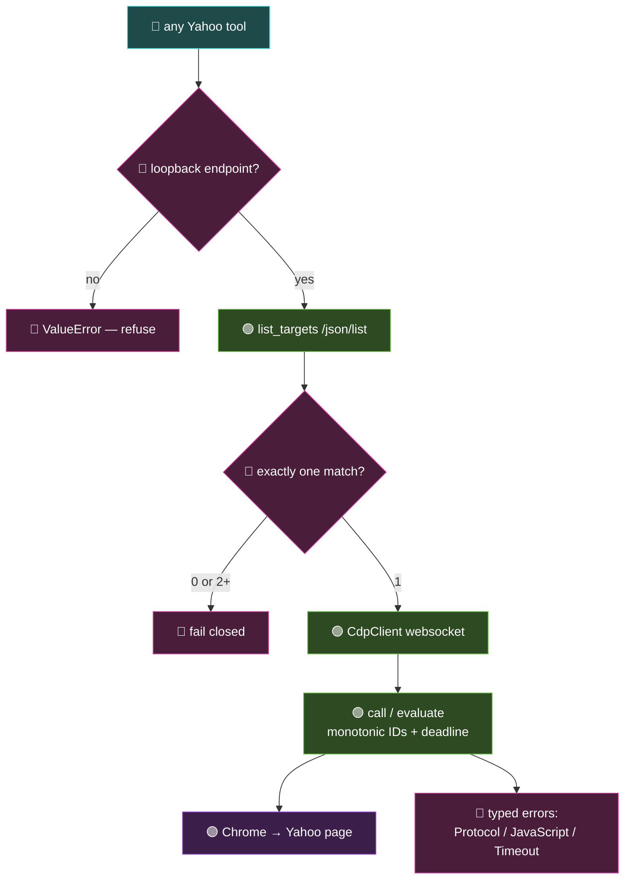

---

## waf.py — block detection

One shared signature: `denied(client)` evaluates
`/Request denied/i.test(document.body.innerText)` on the current page.
Every league/team/wire read checks it, because a WAF page otherwise
parses as misleading *empty* payloads — the block must be named as the
true cause (`LeagueWafBlocked`, `WireScanBlocked`, preflight exit 3).

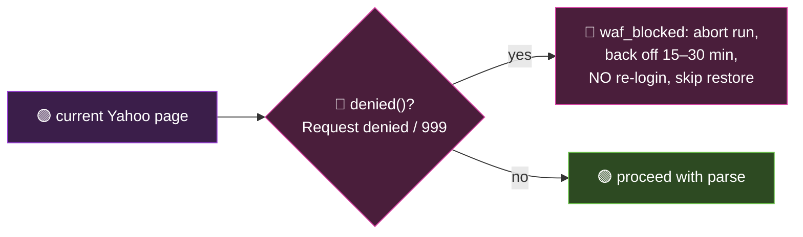

---

## browser.py — find, launch, heal the session

- `chrome_candidates()` / `find_chrome()` — preference order: `CHROME_PATH`,
  the `/tmp/cft` install shared with the games repo, persistent
  `~/Applications` Chrome for Testing.
- `install_chrome_for_testing()` — downloads CfT for this CPU
  (`cft_platform`) when nothing exists.
- `launch(...)` — detached, standard operator flags: loopback debug port,
  `--remote-allow-origins=*`, `--use-mock-keychain` (CfT is ad-hoc signed;
  without the flag cookies are memory-only and every login dies with the
  process).
- `cdp_alive()` / `ensure_browser()` — guarantee an answering endpoint;
  restore the profile backup first when the profile dir is missing.
- `backup_profile()` / `restore_profile()` — snapshot/restore cookies +
  saved logins (minus caches/locks) to `~/edge-profile-backups/`.

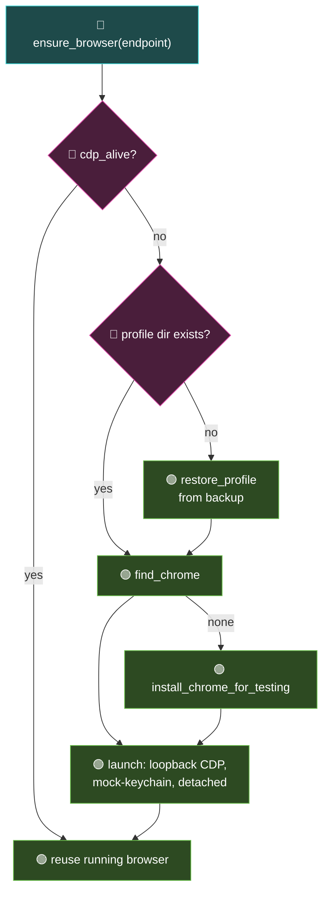

---

## team.py — the authoritative roster read

- `BASE`, `LEAGUE_ID`, `TEAM_ID`, `TEAM_PATH`, `TEAM_URL` — the canonical
  Yahoo host/id constants for the whole repo. Every tool and `yahoo/`
  reader imports `BASE` from here; there is no second copy of the host.
- `is_team_url` / `is_team_target` — exactly `/f1/1329011/2`.
- `find_team_target()` — heals drift: no tab on the team route but one
  anywhere on the fantasy host → navigate it home (one load). No
  fantasy-host tab → fail closed (session-liveness signal; a
  sports.yahoo.com article is never hijacked). Two tabs on the exact
  route → fatal ambiguity.
- `YahooTeamReader.snapshot()` — fails closed unless: path exact, FD
  nation / Shiba Innu identity present, 15 unique active IDs (+ ≤2 IR),
  nine starters + six bench slots, record/matchup/waiver parse.
- `RosterPlayer` — Yahoo ID, slot, injury, game text, **locked** flag
  (locked rows are parsed too — the #79 fix; a kicked-off player must
  not vanish from the roster).

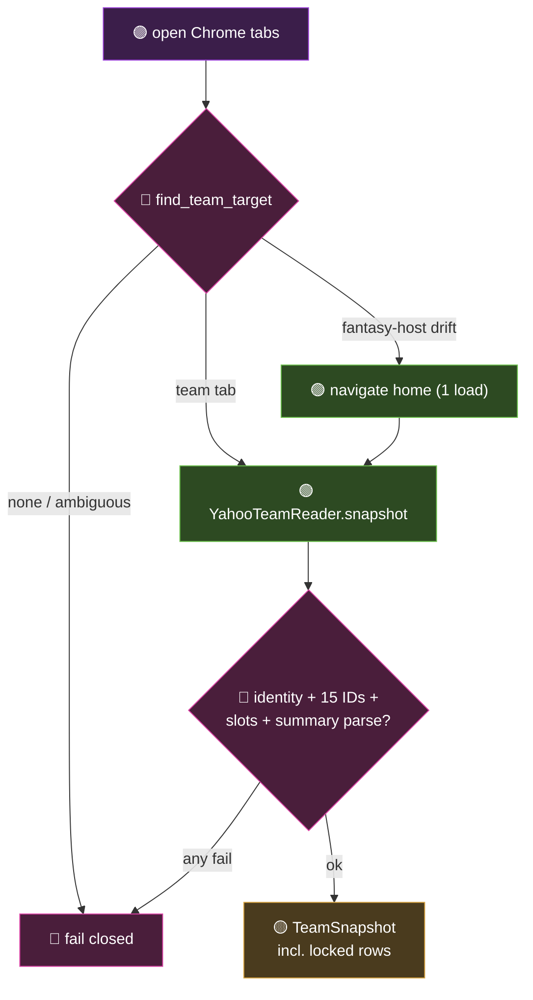

---

## league.py — league-wide reads

All read-only; every function fails fast on the WAF signature
(`_fail_if_denied`).

- `standings()` — the league-home table → `StandingsRow`s (rank, record,
  PF/PA…). `team_ids()` — names → Yahoo roster numbers.
- `scoreboard()` — **every matchup of the week, free** off the league
  home page's JS payload (`_parse_scoreboard_entries`, pure/testable).
- `matchup()` — our live matchup score (`_build_matchup_score`, pure).
- `team_logos()` — avatar URLs from the standings table (fed to logo_sync).
- `opponent_roster(team_id)` — another team's roster incl. Yahoo **Proj
  Pts** (the cell after `td.pts`; bye rows merge cells → null, never a
  guess). The authorized team ID is refused here (use team.py).
- `my_roster()` — our own roster with the same JS, evaluated **in place**
  on the team page (zero navigation; the nightly report's last read).
- `opponent_team_id()` — current opponent from matchup-page links.

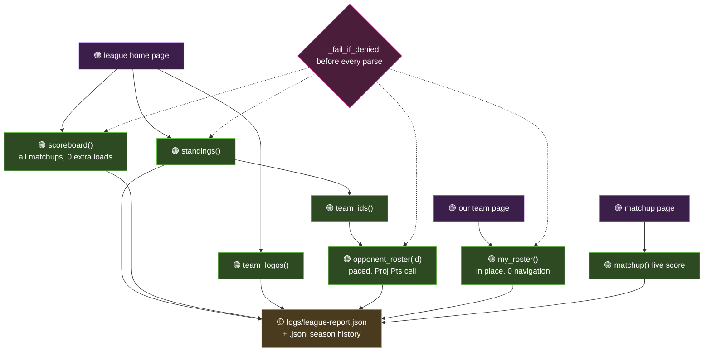

---

## players.py + identity.py — available players and the ID bridge

**players.py**
- `YahooPlayerReader.page(pos, offset)` — one available-player result
  page → `AvailablePlayer`s (Yahoo ID, name, team, position, availability
  `FA` / `W (date)`, injury, game text). Read-only, identity-checked.

**identity.py**
- `reconcile_identities(roster, available, projections)` — resolves Yahoo
  IDs to internal model IDs by **unique full-name + position + current
  NFL team** match. Never expands initials/abbreviations.
- Statuses: `actionable`, `team_mismatch`, `unmapped`, `ambiguous` —
  anything not actionable **fails closed** for recommendations/mutations.
- `write_identity_map()` — persists `logs/yahoo-player-map.json`
  (runtime state, git-ignored; rebuild before each decision).

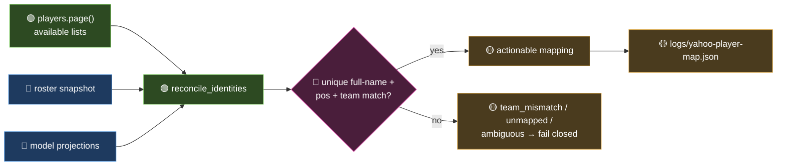

---

## lineup.py — exact lineup permutations

`YahooLineupOperator.apply(moves)`:
1. Re-read the authoritative roster; verify each move's **expected current
   slot** and that Yahoo offers the destination unlocked.
2. Prove the complete permutation preserves legal slot counts.
3. Submit the exact roster form (one POST, never retried).
4. **Read back** a second authoritative snapshot; success only when every
   requested slot is present. Already-applied → `already_applied`, no
   second submission. `LineupReceipt` records the verified result.

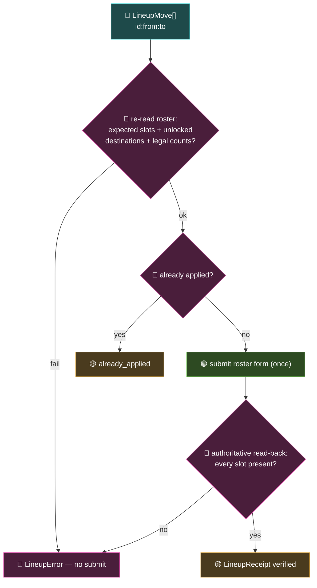

---

## waivers.py — exact add/drop claims

`YahooWaiverOperator.prepare()` / `.apply()` — one transaction, staged:
verify the drop player against the authoritative roster → select exact
add/drop IDs → stage-2 confirmation re-verifies IDs → submit (never
replay a POST) → read back:
- waiver claim → `pending` when add+drop appear together in the
  waiver-transactions view (`_pending`);
- immediate FA add → `completed` after exact-ID roster read-back
  (add present, drop gone — `_on_roster`).
Repeating a pending claim → `already_pending`. Every run appends a
redacted record to `logs/yahoo-waiver-audit.jsonl`. `restore_team()`
returns the tab home (skipped when WAF-blocked).

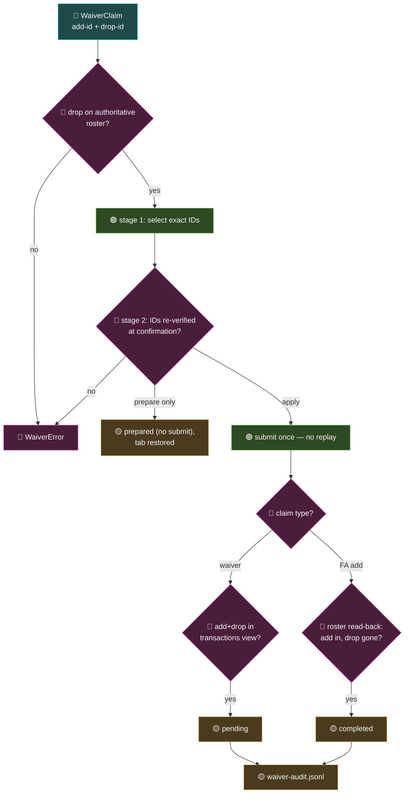

---

## wire.py — the waiver-wire scan

- `scan_available(client)` — paginates the QB/RB/WR/TE available lists
  (first pages only; top targets sort first), WAF check on every page →
  `WireScanBlocked` aborts instantly.
- `rank_targets(available, projections)` — identity-reconciled ranking by
  `proj_week`; unmapped players stay visible, never silently ranked.

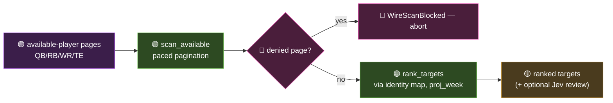

---

## recommend.py — the start/sit brain

Pure logic over a snapshot + weekly projections (no browser):
- `propose_lineup(snapshot, proj_week, pinned_ids, ...)` — best legal
  lineup and the **exact moves** to reach it; pinned and game-locked
  players keep their current slots; `PlayerPlan` per player,
  `LineupProposal` with warnings.
- `apply_schedule_locks(...)` — cross-checks DOM lock state against the
  schedule's kickoff times (a discrepancy is a warning, not a guess).
- `monitor_report(...)` — the daily monitor block: injuries, byes,
  unevaluated players, locks — what needs a human eye.

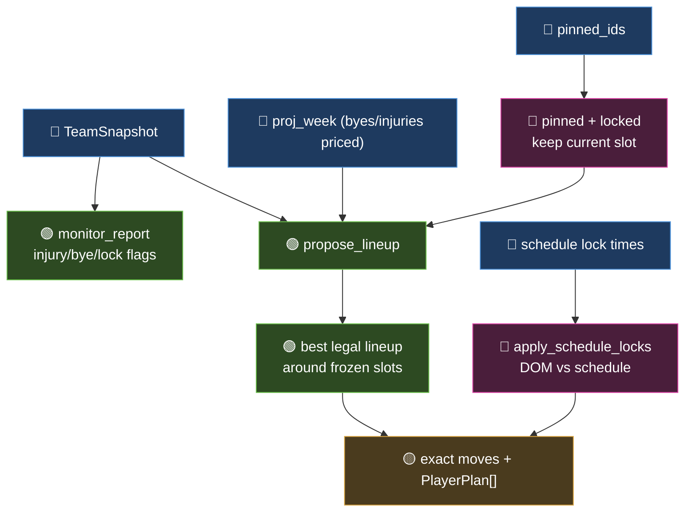

---

## league_strength.py — pure league analysis

No browser; hermetically tested. Used by `tools/team_analyzer.py`.
- `evaluate_roster` / `optimal_lineup` / `optimal_score` — model values on
  a roster + best legal lineup.
- `position_ranks` — my best rostered player vs the league's best, per
  position.
- `bye_weeks` / `bye_concentration` — team bye map; weeks with 2+ starters
  out.
- `dead_spots` / `drop_candidates` — worthless/unpriceable rostered
  players; only bench players with no model value are safe drop
  nominations (model blind spots are flagged "verify manually", never
  auto-drop).
- `recommendations` — transparent rule-based ranked list; `render_report`
  for the terminal.

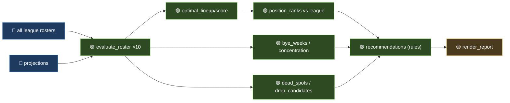